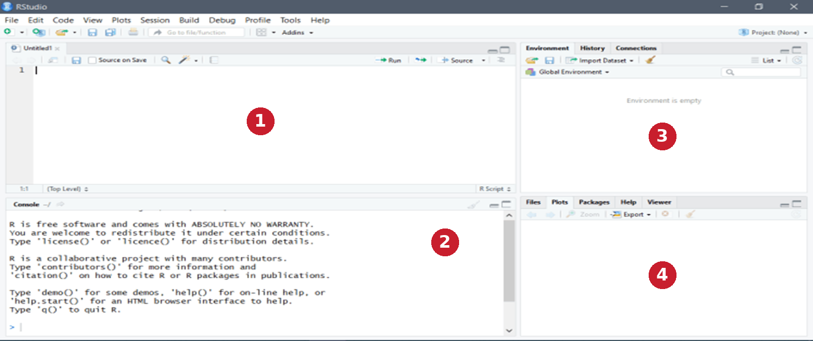

```{r}
#| label: setup
#| include: false
library(ggplot2)
theme_set(theme_minimal(base_size = 13))
```

::: {.callout-note title="Objetivos del capítulo"}
Al terminar este capítulo, usted estará en capacidad de:

- distinguir entre población y muestra, y entre parámetro y estadístico;
- clasificar variables según su naturaleza y su escala de medida;
- resumir datos cualitativos y cuantitativos mediante tablas y gráficos adecuados;
- calcular e interpretar medidas de tendencia central, dispersión, posición y forma;
- realizar un análisis descriptivo completo usando R.
:::

## ¿Qué es la estadística?

Todos los días tomamos decisiones a partir de información incompleta. Un
ingeniero debe decidir si un lote de concreto cumple la resistencia exigida
sin poder ensayar cada metro cúbico; un economista estima la tasa de
desempleo del país sin entrevistar a todos los hogares; un médico evalúa si
un tratamiento funciona observando solo a algunos pacientes. En todos estos
casos aparece el mismo problema: **los datos varían**. Dos cilindros de la
misma mezcla de concreto no resisten exactamente lo mismo, dos hogares
parecidos no tienen el mismo ingreso y dos pacientes no responden igual al
mismo medicamento. La estadística existe precisamente para razonar con
rigor en presencia de esa variabilidad [@walpole2012, p. 2].

::: {#def-estadistica name="Estadística"}
La **estadística** es la ciencia que se ocupa de recolectar, organizar,
resumir, analizar e interpretar datos, con el fin de describir fenómenos y
apoyar la toma de decisiones en condiciones de incertidumbre.
:::

Tradicionalmente se distinguen dos grandes ramas:

- La **estadística descriptiva** organiza y resume los datos disponibles
  mediante tablas, gráficos y medidas numéricas. Responde preguntas como
  *¿cómo se comportaron estos datos?* Es el objeto de este capítulo.
- La **estadística inferencial** utiliza la información de una parte del
  conjunto (la muestra) para obtener conclusiones sobre el todo (la
  población), cuantificando el riesgo de equivocarse. Responde preguntas
  como *¿qué podemos afirmar, y con qué confianza, más allá de estos datos?*
  Es el objeto del curso de Estadística II.

Entre ambas está la **probabilidad** (capítulos 2 a 4), que proporciona el
lenguaje matemático para medir la incertidumbre y hace posible el paso de
la muestra a la población.

::: {.callout-tip title="Idea clave"}
Si todos los datos fueran iguales, bastaría con observar uno solo y la
estadística no sería necesaria. Su razón de ser es la **variabilidad**:
describirla, entender de dónde viene y tenerla en cuenta al sacar
conclusiones.
:::

## Población, muestra, parámetro y estadístico

::: {#def-unidad name="Unidad de observación"}
Una **unidad de observación** (o unidad estadística) es cada uno de los
elementos sobre los cuales se registra información: una persona, una
empresa, un hogar, una pieza fabricada, un municipio, un día.
:::

::: {#def-poblacion name="Población"}
La **población** es el conjunto completo de unidades de observación que son
de interés en un estudio. Su tamaño se denota con $N$.
:::

::: {#def-muestra name="Muestra"}
Una **muestra** es un subconjunto de la población que efectivamente se
observa. Su tamaño se denota con $n$.
:::

Cuando se observa a toda la población se dice que se realiza un **censo**.
En la práctica casi siempre se trabaja con muestras, por varias razones: el
costo y el tiempo de observar a todos, la imposibilidad de acceder a toda la
población y, en algunos casos, porque la medición destruye la unidad (para
conocer la resistencia de un cilindro de concreto hay que romperlo).

Para que la muestra permita sacar conclusiones confiables sobre la
población, debe ser **representativa**. La forma más sencilla de
procurarlo es seleccionarla **al azar**, de modo que el investigador no
influya en qué unidades quedan incluidas. Una encuesta respondida solo por
quienes deciden participar en redes sociales, por ejemplo, puede estar
sesgada aunque tenga miles de respuestas.

::: {#def-parametro name="Parámetro"}
Un **parámetro** es una medida numérica que describe una característica de
la **población**. Es un valor fijo, pero en general desconocido.
:::

::: {#def-estadistico name="Estadístico"}
Un **estadístico** es una medida numérica calculada a partir de los datos
de una **muestra**. Su valor es conocido una vez se observa la muestra, pero
cambia de una muestra a otra.
:::

Para no confundirlos, se usa una notación distinta: los parámetros se
denotan habitualmente con letras griegas y los estadísticos con letras
latinas o con un "gorro" sobre el símbolo del parámetro.

| Característica       | Parámetro (población) | Estadístico (muestra) |
|:---------------------|:---------------------:|:---------------------:|
| Tamaño               | $N$                   | $n$                   |
| Media                | $\mu$                 | $\bar{x}$             |
| Varianza             | $\sigma^2$            | $s^2$                 |
| Desviación estándar  | $\sigma$              | $s$                   |
| Proporción           | $p$                   | $\hat{p}$             |
| Correlación          | $\rho$                | $r$                   |

: Notación habitual para parámetros y estadísticos. {#tbl-notacion}

::: {#exm-desempleo}
La tasa de desempleo de Colombia en un mes determinado es un
**parámetro**: describe a toda la población económicamente activa del país.
Nadie conoce su valor exacto. La cifra que publica el DANE se calcula a
partir de una encuesta a una muestra de hogares (la Gran Encuesta Integrada
de Hogares), de modo que es un **estadístico** que se usa para estimar ese
parámetro.
:::

::: {.callout-important title="Por qué importa la distinción"}
Como el estadístico cambia de una muestra a otra, es en sí mismo una
cantidad que varía. Estudiar cómo varía (su *distribución muestral*,
capítulo 4) es lo que permite, más adelante, construir intervalos de
confianza y pruebas de hipótesis.
:::

## Variables y datos

::: {#def-variable name="Variable"}
Una **variable** es una característica de las unidades de observación que
puede tomar distintos valores de una unidad a otra.
:::

### Variables determinísticas y aleatorias

Una variable es **determinística** cuando su valor queda completamente
determinado por condiciones conocidas, de manera que, repitiendo esas
condiciones, se obtiene siempre el mismo resultado. Por ejemplo, el área de
un terreno rectangular de lados conocidos, o el valor final de un CDT con
una tasa de interés fija y un plazo pactado.

Una variable es **aleatoria** cuando, aun repitiendo las mismas
condiciones, su valor no puede predecirse con certeza. Por ejemplo, el
número de clientes que llegan a un banco entre las 9 y las 10 de la mañana,
el tiempo de espera de un bus, o la resistencia de dos cilindros de concreto
fabricados con la misma mezcla. La estadística se ocupa de las variables
aleatorias; su definición formal se presenta en el capítulo 3.

### Variables cualitativas y cuantitativas

::: {#def-cualitativa name="Variable cualitativa"}
Una variable es **cualitativa** (o **categórica**) cuando sus valores son
categorías o atributos que clasifican a las unidades. Por ejemplo: carrera,
grupo sanguíneo, sector económico de una empresa, nivel de satisfacción.
:::

::: {#def-cuantitativa name="Variable cuantitativa"}
Una variable es **cuantitativa** (o **numérica**) cuando sus valores son
números que resultan de contar o de medir, y con los cuales tiene sentido
hacer operaciones aritméticas. Por ejemplo: número de hijos, ingreso
mensual, estatura, tiempo de espera.
:::

::: {.callout-warning title="Cuidado con los códigos numéricos"}
Que una variable se registre con números no la hace cuantitativa. El
estrato socioeconómico (1 a 6), el código de una carrera o el número de
cédula son números, pero funcionan como etiquetas de categorías. Una prueba
sencilla es preguntarse: *¿tiene sentido calcular el promedio?* El promedio
de los números de cédula de un curso no significa nada.
:::

### Variables cuantitativas discretas y continuas

::: {#def-discreta name="Variable discreta"}
Una variable cuantitativa es **discreta** cuando solo puede tomar valores
aislados, que pueden enumerarse (finitos o infinitos numerables).
Habitualmente surge de **contar**: número de hijos, número de defectos en
una lámina, número de accidentes en una semana.
:::

::: {#def-continua name="Variable continua"}
Una variable cuantitativa es **continua** cuando puede tomar, al menos en
principio, cualquier valor dentro de un intervalo de números reales.
Habitualmente surge de **medir**: estatura, peso, tiempo, temperatura,
resistencia de un material.
:::

En la práctica todo instrumento tiene una precisión limitada, así que los
datos de una variable continua se registran con un número finito de
decimales. Eso no cambia la naturaleza de la variable: la edad es continua
aunque la anotemos en años cumplidos. A la inversa, algunas variables
técnicamente discretas, como el dinero (que se mide en pesos), suelen
tratarse como continuas porque toman una cantidad muy grande de valores
posibles.

La @tbl-clasificacion resume la clasificación con ejemplos de distintas
áreas.

| Tipo                       | Ingeniería                     | Economía y administración      | Salud                     |
|:---------------------------|:-------------------------------|:-------------------------------|:--------------------------|
| Cualitativa                | Tipo de falla de un equipo     | Sector económico de la empresa | Grupo sanguíneo           |
| Cuantitativa discreta      | Número de defectos por lámina  | Número de empleados            | Número de consultas al año|
| Cuantitativa continua      | Resistencia del concreto (MPa) | Ingreso mensual del hogar      | Presión arterial          |

: Clasificación de variables con ejemplos de varias áreas. {#tbl-clasificacion}

### Datos y matriz de datos

::: {#def-dato name="Dato"}
Un **dato** es el valor observado de una variable en una unidad de
observación concreta.
:::

Los datos de un estudio se organizan en una **matriz de datos** (o base de
datos) en la que cada **fila** corresponde a una unidad de observación,
cada **columna** a una variable y cada **celda** a un dato. Esta forma de
organización, llamada *ordenada* (*tidy*), facilita enormemente el análisis
con software [@wickham2014; @wickham2023].

| Estudiante | Carrera          | Estrato | Créditos | Estatura (cm) |
|:----------:|:-----------------|:-------:|:--------:|:-------------:|
| 1          | Ingeniería Civil | 3       | 18       | 172,4         |
| 2          | Economía         | 2       | 16       | 160,1         |
| 3          | Química          | 4       | 20       | 168,9         |
| 4          | Economía         | 3       | 15       | 175,0         |
| 5          | Ingeniería Civil | 1       | 18       | 158,3         |
| 6          | Física           | 2       | 17       | 181,2         |

: Una pequeña matriz de datos (ficticia): cada fila es un estudiante y cada columna una variable. {#tbl-matriz}

En la @tbl-matriz, el valor `Economía` en la fila 2 es un dato de la
variable *carrera*; el valor `175,0` en la fila 4 es un dato de la
variable *estatura*.

<!-- PENDIENTE: presentar aquí la base de datos del curso (carpeta datos/),
     con su fuente y el diccionario de variables. -->

## Escalas de medida

Además de distinguir entre variables cualitativas y cuantitativas, conviene
precisar **qué información contienen sus valores**, porque de ello depende
qué operaciones y qué resúmenes tienen sentido. La clasificación más usada,
propuesta originalmente por @stevens1946 y adoptada por los textos actuales
[@anderson2008, p. 6], distingue cuatro escalas de medida.

**Escala nominal.** Los valores solo identifican categorías, sin ningún
orden entre ellas. Lo único que puede afirmarse es si dos unidades
pertenecen o no a la misma categoría. Ejemplos: género, carrera, grupo
sanguíneo, municipio de nacimiento. Si se codifica el género como
Femenino = 0 y Masculino = 1, esos números no representan cantidades ni
establecen una jerarquía: son solo etiquetas.

**Escala ordinal.** Las categorías tienen un orden natural, pero las
distancias entre ellas no son medibles. Puede afirmarse que un valor es
mayor o menor que otro, pero no cuánto. Ejemplos: estrato socioeconómico,
nivel educativo, nivel de satisfacción (de "muy insatisfecho" a "muy
satisfecho"). Que el estrato 4 sea mayor que el 2 no significa que esté "el
doble" de arriba, y la resta entre estratos tampoco tiene sentido.

**Escala de intervalo.** Los valores son numéricos y las **diferencias**
entre ellos tienen sentido, pero el cero es arbitrario: no indica ausencia
de la característica. Ejemplos: temperatura en grados Celsius o Fahrenheit,
año calendario. Pasar de 10 °C a 20 °C implica el mismo aumento que pasar de
20 °C a 30 °C, pero un día a 40 °C no es "el doble de caliente" que uno a
20 °C, porque 0 °C no es ausencia de temperatura.

**Escala de razón.** Además de diferencias, tienen sentido los
**cocientes**, porque existe un cero absoluto que sí indica ausencia de la
característica. Ejemplos: peso, estatura, ingreso, tiempo de espera,
temperatura en kelvin. Un peso de 80 kg sí es el doble de uno de 40 kg.

Las escalas están anidadas: cada una conserva las propiedades de las
anteriores y añade una nueva. Las variables cualitativas se miden en escala
nominal u ordinal, y las cuantitativas en escala de intervalo o de razón.

| Escala    | Comparaciones con sentido | Ejemplos                          | Resúmenes adecuados (se acumulan)          |
|:----------|:--------------------------|:----------------------------------|:-------------------------------------------|
| Nominal   | $=, \neq$                 | Género, grupo sanguíneo           | Frecuencias, proporciones, moda            |
| Ordinal   | $<, >$                    | Estrato, nivel de satisfacción    | Además: mediana, cuartiles, percentiles    |
| Intervalo | Diferencias               | Temperatura en °C, año calendario | Además: media, desviación estándar         |
| Razón     | Cocientes                 | Peso, ingreso, tiempo             | Además: coeficiente de variación           |

: Escalas de medida, operaciones permitidas y resúmenes adecuados. {#tbl-escalas}

::: {.callout-note title="Una advertencia sobre las escalas"}
La clasificación de Stevens es una guía muy útil, pero no debe aplicarse
como una regla mecánica: el análisis adecuado depende también de la
pregunta que se quiere responder y del significado de los datos. Un caso
frecuente es el de las escalas tipo Likert (por ejemplo, de 1 a 5): en
sentido estricto son ordinales, pero en muchas disciplinas se promedian. @sullivan2013 discuten cuándo es razonable hacerlo y cuándo conviene usar
resúmenes propios de datos ordinales, como la mediana y las frecuencias.
Promediar no es automáticamente un error, pero sí exige justificarlo e
interpretar el resultado con cautela.
:::

## Análisis de datos cualitativos

Una vez recolectados los datos, el primer paso no es aplicar fórmulas sino
**familiarizarse con ellos**: ver qué valores aparecen, con qué frecuencia,
si hay errores de digitación o categorías inesperadas, y qué patrones
sugieren. Esta etapa recibe el nombre de **análisis exploratorio de
datos**, una idea que @tukey1977 convirtió en parte central del trabajo
estadístico y que hoy es el punto de partida de cualquier análisis
[@wickham2023]. Para explorar los datos se usan dos herramientas
complementarias: las **tablas**, que muestran los valores exactos, y los
**gráficos**, que permiten captar de un vistazo la forma general de los
datos [@anderson2008, p. 26; @devore2008, p. 4].

En esta sección nos ocupamos de las variables cualitativas (escalas
nominal y ordinal). Los mismos gráficos y tablas los construiremos más
adelante con R; por ahora el objetivo es entender qué muestran y cómo se
interpretan.

### Tabla de frecuencias

Supongamos que se han observado $n$ unidades y que la variable
cualitativa tiene $k$ categorías $C_1, C_2, \ldots, C_k$. Para que la tabla
de frecuencias esté bien construida, las categorías deben cumplir dos
condiciones distintas y complementarias:

- **Mutuamente excluyentes:** ningún dato puede pertenecer a dos
  categorías a la vez (no hay traslapes).
- **Exhaustivas:** ningún dato queda sin categoría (no hay faltantes).

Juntas garantizan que cada dato se cuente **exactamente una vez**. Por
ejemplo, las categorías de edad "18 a 25 años" y "25 a 35 años" no son
excluyentes, porque una persona de 25 años cabe en ambas. Y si se clasifica
la carrera de los estudiantes de un curso solo en "Ingeniería" y
"Economía" cuando también hay estudiantes de Física, las categorías no son
exhaustivas; se corrige agregando las categorías que falten o una
categoría "Otra".

::: {#def-frecuencias name="Frecuencias absoluta y relativa"}
La **frecuencia absoluta** $f_i$ de la categoría $C_i$ es el número de
unidades que pertenecen a ella. La **frecuencia relativa** $h_i$ es la
proporción de unidades en esa categoría:
$$
h_i = \frac{f_i}{n}, \qquad i = 1, \ldots, k.
$$
Multiplicada por 100, la frecuencia relativa se expresa como
**porcentaje**.
:::

De la definición se desprenden dos propiedades útiles para verificar los
cálculos:
$$
\sum_{i=1}^{k} f_i = n \qquad \text{y} \qquad \sum_{i=1}^{k} h_i = 1.
$$

::: {.callout-note title="Notación que usaremos"}
| Símbolo | Nombre                          | Significado                                          |
|:-------:|:--------------------------------|:-----------------------------------------------------|
| $f_i$   | Frecuencia absoluta             | Número de datos en la categoría o clase $i$          |
| $h_i$   | Frecuencia relativa             | Proporción de datos en la categoría o clase $i$: $h_i = f_i/n$ |
| $F_i$   | Frecuencia absoluta acumulada   | Número de datos en la categoría o clase $i$ o en las anteriores: $F_i = f_1 + \cdots + f_i$ |
| $H_i$   | Frecuencia relativa acumulada   | Proporción acumulada: $H_i = F_i/n$                  |

Las frecuencias acumuladas solo tienen sentido cuando las categorías tienen
un orden, es decir, para variables ordinales y cuantitativas.
:::

::: {#def-tabla-frecuencias name="Tabla de frecuencias"}
Una **tabla de frecuencias** organiza los datos de una variable cualitativa
listando sus categorías junto con sus frecuencias absolutas y relativas.
:::

| Categoría | Frecuencia absoluta | Frecuencia relativa |
|:---------:|:-------------------:|:-------------------:|
| $C_1$     | $f_1$               | $h_1 = f_1/n$       |
| $C_2$     | $f_2$               | $h_2 = f_2/n$       |
| $\vdots$  | $\vdots$            | $\vdots$            |
| $C_k$     | $f_k$               | $h_k = f_k/n$       |
| Total     | $n$                 | $1$                 |

: Estructura general de una tabla de frecuencias. {#tbl-frec-general}

Cuando la variable es **ordinal**, las categorías tienen un orden y por
eso también tiene sentido acumular: la **frecuencia absoluta acumulada**
$F_i = f_1 + \cdots + f_i$ cuenta cuántas unidades están en la categoría
$C_i$ o en alguna anterior, y la **frecuencia relativa acumulada**
$H_i = F_i / n$ da la proporción correspondiente. Por ejemplo, con el
estrato permitiría responder "¿qué porcentaje de los estudiantes vive en
estrato 3 o inferior?". En una variable nominal, en cambio, acumular no
tiene interpretación, porque el orden de las categorías es arbitrario.

En una variable nominal, el único resumen numérico de "valor típico" que
tiene sentido es la **moda**: la categoría con mayor frecuencia. Una
variable puede tener más de una moda si varias categorías empatan en la
frecuencia más alta.

::: {#exm-colores}
Se preguntó a un grupo de personas qué color preferirían al comprar un
vehículo y se obtuvieron las siguientes respuestas:

> Gris, Verde, Gris, Verde, Blanco, Negro, Amarillo, Azul, Gris, Gris,
> Gris, Verde, Negro, Amarillo, Blanco, Blanco, Negro, Verde, Verde, Azul,
> Negro, Gris, Verde, Gris, Negro.

La **unidad de observación** es cada persona encuestada; las $n = 25$
personas constituyen una **muestra** de la población de posibles
compradores de vehículos. La **variable** es el color preferido, que es
**cualitativa** y se mide en escala **nominal**, pues los colores no tienen
un orden natural. Contando cuántas veces aparece cada color se obtiene la @tbl-colores.

```{r}
#| label: datos-colores
#| echo: false
colores <- c("Gris", "Verde", "Gris", "Verde", "Blanco",
             "Negro", "Amarillo", "Azul", "Gris", "Gris",
             "Gris", "Verde", "Negro", "Amarillo", "Blanco",
             "Blanco", "Negro", "Verde", "Verde", "Azul",
             "Negro", "Gris", "Verde", "Gris", "Negro")

frec <- sort(table(colores), decreasing = TRUE)
df_colores <- data.frame(Color = names(frec), f_i = as.vector(frec))
df_colores$h_i  <- df_colores$f_i / sum(df_colores$f_i)
df_colores$porc <- 100 * df_colores$h_i
```

```{r}
#| label: tbl-colores
#| tbl-cap: "Distribución de frecuencias del color de vehículo preferido."
#| echo: false
tabla_colores <- rbind(
  df_colores,
  data.frame(Color = "Total", f_i = sum(df_colores$f_i), h_i = 1, porc = 100)
)
knitr::kable(tabla_colores, format = "pipe",
             col.names = c("Color", "$f_i$", "$h_i$", "Porcentaje (%)"),
             digits = c(0, 0, 2, 1), align = "lccc")
```

El color más preferido (la **moda**) es el gris, elegido por 7 de las 25
personas, es decir, el 28 % de la muestra. Le siguen el verde (24 %) y el
negro (20 %); entre estos tres colores reúnen el 72 % de las preferencias.
:::

### Representación gráfica

::: {#def-barras name="Diagrama de barras"}
Un **diagrama de barras** representa cada categoría mediante un rectángulo
cuya altura (o longitud, si las barras son horizontales) es proporcional a
su frecuencia, absoluta o relativa. Todas las barras tienen el mismo ancho
y se dibujan separadas, para indicar que las categorías son distintas y no
forman un continuo.
:::

::: {#def-circular name="Diagrama circular"}
Un **diagrama circular** (o de pastel) representa el total de los datos
como un círculo dividido en sectores, uno por categoría, cuyo ángulo es
proporcional a su frecuencia relativa: el sector de la categoría $C_i$
tiene un ángulo de $360° \times h_i$.
:::

```{r}
#| label: fig-barras-colores
#| fig-cap: "Diagrama de barras del color de vehículo preferido (n = 25)."
#| echo: false
#| fig-width: 6
#| fig-height: 3.8
ggplot(df_colores, aes(x = reorder(Color, -f_i), y = f_i)) +
  geom_col(fill = "steelblue", width = 0.7) +
  geom_text(aes(label = f_i), vjust = -0.4) +
  labs(x = "Color preferido", y = "Frecuencia absoluta") +
  ylim(0, 8)
```

```{r}
#| label: fig-circular-colores
#| fig-cap: "Diagrama circular del color de vehículo preferido (n = 25)."
#| echo: false
#| fig-width: 5
#| fig-height: 4
ggplot(df_colores, aes(x = "", y = f_i, fill = Color)) +
  geom_col(width = 1, color = "white") +
  coord_polar(theta = "y") +
  geom_text(aes(label = paste0(round(porc), " %")),
            position = position_stack(vjust = 0.5)) +
  labs(fill = "Color") +
  theme_void()
```

La @fig-barras-colores y la @fig-circular-colores muestran la misma
información. Sin embargo, en el diagrama de barras es mucho más fácil
comparar categorías: se ve de inmediato que el gris supera al verde, algo
que en el diagrama circular cuesta distinguir sin leer los porcentajes.
Esto no es casual. Los estudios de percepción visual muestran que las
personas comparamos con más precisión longitudes alineadas sobre una misma
base que ángulos o áreas [@healy2018]. Por eso conviene seguir algunas
recomendaciones [@wilke2019]:

- Preferir el **diagrama de barras** como opción por defecto, ordenando las
  barras de mayor a menor frecuencia cuando la variable es nominal, y
  respetando el orden natural de las categorías cuando es ordinal.
- Reservar el **diagrama circular** para cuando interesa destacar la
  relación de cada parte con el total, y solo si hay pocas categorías (dos
  a cuatro).
- Rotular siempre los ejes, indicar el tamaño de la muestra y evitar
  efectos tridimensionales, que distorsionan las proporciones.

### Tablas de contingencia

Hasta ahora hemos estudiado una variable a la vez. Con frecuencia, sin
embargo, interesa saber si dos variables cualitativas están relacionadas:
¿el hábito de fumar es igual de frecuente en hombres que en mujeres?, ¿el
medio de transporte que usan los estudiantes depende de su estrato? Para
esto se organizan los datos **bivariados** en una tabla de doble entrada.

::: {#def-contingencia name="Tabla de contingencia"}
Una **tabla de contingencia** (o tabla cruzada) organiza los datos de dos
variables cualitativas: las filas corresponden a las categorías de una
variable, las columnas a las de la otra, y cada celda contiene la
frecuencia $f_{ij}$ de unidades que pertenecen simultáneamente a la
categoría $i$ de la primera variable y a la categoría $j$ de la segunda.
Los totales por fila, $f_{i\cdot}$, y por columna, $f_{\cdot j}$, se
llaman **frecuencias marginales**, y el total general es $n$.
:::

::: {#exm-fumar}
En una muestra de 233 personas se registró el género y si tienen o no el
hábito de fumar. Los resultados se presentan en la @tbl-fumar.

| Hábito de fumar | Hombre | Mujer | Total |
|:----------------|:------:|:-----:|:-----:|
| Sí              | 65     | 58    | 123   |
| No              | 43     | 67    | 110   |
| Total           | 108    | 125   | 233   |

: Hábito de fumar según género: frecuencias absolutas. {#tbl-fumar}

Las frecuencias absolutas por sí solas pueden engañar. Hay 65 hombres
fumadores y 58 mujeres fumadoras, pero eso no basta para concluir que los
hombres fuman más, porque en la muestra hay más mujeres (125) que hombres
(108). Para comparar hay que pasar a porcentajes, y en una tabla de
contingencia hay **tres formas** de calcularlos, cada una de las cuales
responde a una pregunta diferente:

- **Respecto al total general** ($f_{ij}/n$): ¿qué porcentaje de *todas*
  las personas son hombres fumadores? $65/233 \approx 0{,}279$, es decir, el 27,9 %.
- **Respecto al total de cada columna** ($f_{ij}/f_{\cdot j}$): ¿qué
  porcentaje de los *hombres* fuma? $65/108 \approx 0{,}602$, es decir, el 60,2 %. ¿Y de las
  *mujeres*? $58/125 = 0{,}464$, es decir, el 46,4 %.
- **Respecto al total de cada fila** ($f_{ij}/f_{i\cdot}$): de las personas
  *que fuman*, ¿qué porcentaje son hombres? $65/123 \approx 0{,}528$, es decir, el 52,8 %.

Para responder si el hábito de fumar se relaciona con el género, la
comparación adecuada es la de los porcentajes por columna (@tbl-fumar-col):
en esta muestra fuma el 60,2 % de los hombres frente al 46,4 % de las
mujeres.

| Hábito de fumar | Hombre (%) | Mujer (%) | Total (%) |
|:----------------|:----------:|:---------:|:---------:|
| Sí              | 60,2       | 46,4      | 52,8      |
| No              | 39,8       | 53,6      | 47,2      |
| Total           | 100,0      | 100,0     | 100,0     |

: Hábito de fumar según género: porcentajes por columna. {#tbl-fumar-col}

```{r}
#| label: fig-fumar
#| fig-cap: "Hábito de fumar según género (porcentajes por columna)."
#| echo: false
#| fig-width: 5.5
#| fig-height: 3.8
fumar <- data.frame(
  genero = rep(c("Hombre", "Mujer"), each = 2),
  fuma   = rep(c("Sí", "No"), times = 2),
  n      = c(65, 43, 58, 67)
)
fumar$porc <- 100 * fumar$n / ave(fumar$n, fumar$genero, FUN = sum)
fumar$fuma <- factor(fumar$fuma, levels = c("No", "Sí"))

ggplot(fumar, aes(x = genero, y = porc, fill = fuma)) +
  geom_col(width = 0.6) +
  geom_text(aes(label = paste0(round(porc, 1), " %")),
            position = position_stack(vjust = 0.5), color = "white") +
  scale_fill_manual(values = c("No" = "grey55", "Sí" = "firebrick")) +
  labs(x = "Género", y = "Porcentaje", fill = "¿Fuma?")
```

La @fig-fumar, un **diagrama de barras apiladas al 100 %**, muestra la
misma comparación: cada barra representa a todas las personas de un género
y se divide según el hábito de fumar.
:::

::: {.callout-tip title="Conexión con el capítulo 2"}
Los tres tipos de porcentajes de una tabla de contingencia son la base
intuitiva de tres conceptos de probabilidad que estudiaremos en el
capítulo 2: la probabilidad **conjunta** (respecto al total), la
probabilidad **marginal** (los totales de fila y columna) y la probabilidad
**condicional** (respecto al total de una fila o de una columna).
:::

## Análisis de datos cuantitativos

Los datos medidos en escala de intervalo o de razón se denominan **datos
cuantitativos**. Como sus valores son números con significado aritmético,
además de contar cuántas veces aparece cada valor podemos ordenarlos,
agruparlos en intervalos y estudiar cómo se distribuyen a lo largo de la
recta numérica [@devore2008, pp. 12--17].

Para desarrollar la sección usaremos un ejemplo que acompañará también a
la sección siguiente.

::: {#exm-desplazamiento}
Se registró el tiempo, en minutos, que tardan 40 estudiantes en
desplazarse de su casa a la universidad. Los datos, en el orden en que
fueron recolectados, son:

> 14, 48, 20, 26, 23, 18, 39, 28, 17, 20, 64, 7, 35, 22, 58, 25, 30, 40,
> 34, 31, 24, 42, 16, 33, 53, 21, 10, 9, 44, 24, 37, 50, 30, 15, 45, 13,
> 12, 32, 18, 27.

La variable *tiempo de desplazamiento* es cuantitativa continua y se mide
en escala de razón: un tiempo de 0 minutos significa ausencia de
desplazamiento, y 40 minutos es el doble que 20.
:::

```{r}
#| label: datos-tiempos
#| echo: false
tiempos <- c(14, 48, 20, 26, 23, 18, 39, 28, 17, 20, 64, 7, 35, 22, 58,
             25, 30, 40, 34, 31, 24, 42, 16, 33, 53, 21, 10, 9, 44, 24,
             37, 50, 30, 15, 45, 13, 12, 32, 18, 27)
```

### Arreglo ordenado y diagrama de tallo y hojas

Mirar los datos en el orden en que fueron recolectados dice muy poco. El
primer paso para organizarlos es ordenarlos.

::: {#def-arreglo name="Arreglo ordenado"}
Un **arreglo ordenado** es el listado de los valores de un conjunto de
datos (población o muestra) dispuestos de menor a mayor.
:::

Para el @exm-desplazamiento, el arreglo ordenado es:

> 7, 9, 10, 12, 13, 14, 15, 16, 17, 18, 18, 20, 20, 21, 22, 23, 24, 24, 25,
> 26, 27, 28, 30, 30, 31, 32, 33, 34, 35, 37, 39, 40, 42, 44, 45, 48, 50,
> 53, 58, 64.

Ya con esto se identifican de inmediato el valor mínimo (7 minutos), el
máximo (64 minutos) y la zona donde se concentran los datos.

Una forma de ordenar los datos que además muestra su forma es el
**diagrama de tallo y hojas**, propuesto por @tukey1977 y presentado en los
textos actuales como herramienta para conjuntos de datos pequeños
[@devore2008, p. 4; @anderson2008, p. 43]. Cada dato se divide en un **tallo** (los dígitos iniciales,
en este caso las decenas) y una **hoja** (el último dígito, las unidades).
Los tallos se escriben en una columna y, a la derecha de cada uno, sus
hojas ordenadas:

```
Tallo | Hojas
    0 | 7 9
    1 | 0 2 3 4 5 6 7 8 8
    2 | 0 0 1 2 3 4 4 5 6 7 8
    3 | 0 0 1 2 3 4 5 7 9
    4 | 0 2 4 5 8
    5 | 0 3 8
    6 | 4

Leyenda: 1 | 5 representa 15 minutos.
```

Si se gira el diagrama 90 grados, la longitud de cada fila muestra cuántos
datos hay en cada decena: la mayoría de los estudiantes tarda entre 10 y
39 minutos, y unos pocos tardan bastante más. A diferencia de un gráfico,
el diagrama conserva todos los valores originales.

### Variables discretas con pocos valores

Cuando la variable es discreta y toma pocos valores distintos, la tabla de
frecuencias se construye igual que para una variable cualitativa, con una
fila por cada valor. Como los valores son números ordenados, aquí sí
tienen sentido las frecuencias acumuladas: la **frecuencia absoluta
acumulada** $F_i = f_1 + f_2 + \cdots + f_i$ y la **frecuencia relativa
acumulada** $H_i = F_i / n$.

::: {#exm-hermanos}
Se preguntó a 30 estudiantes cuántos hermanos tienen. Los resultados se
resumen en la @tbl-hermanos.

| N.º de hermanos ($x_i$) | $f_i$ | $h_i$ | $F_i$ | $H_i$ |
|:-----------------------:|:-----:|:-----:|:-----:|:-----:|
| 0                       | 5     | 0,167 | 5     | 0,167 |
| 1                       | 11    | 0,367 | 16    | 0,533 |
| 2                       | 8     | 0,267 | 24    | 0,800 |
| 3                       | 4     | 0,133 | 28    | 0,933 |
| 4                       | 2     | 0,067 | 30    | 1,000 |
| Total                   | 30    | 1,000 |       |       |

: Distribución de frecuencias del número de hermanos. {#tbl-hermanos}

La frecuencia acumulada permite responder directamente preguntas como
"¿qué porcentaje de los estudiantes tiene a lo sumo un hermano?": basta
leer $H_2 = 0{,}533$, es decir, el 53,3 %. Del mismo modo, el 80 % tiene dos
hermanos o menos.

Para graficar una variable discreta se usa un **diagrama de bastones**: un
segmento vertical sobre cada valor, de altura igual a su frecuencia (@fig-hermanos). Los bastones son delgados y separados para indicar que
entre un valor y otro no hay datos posibles.

```{r}
#| label: fig-hermanos
#| fig-cap: "Diagrama de bastones del número de hermanos (n = 30)."
#| echo: false
#| fig-width: 5.5
#| fig-height: 3.5
hermanos <- data.frame(x = 0:4, n = c(5, 11, 8, 4, 2))
ggplot(hermanos, aes(x = x, y = n)) +
  geom_segment(aes(xend = x, yend = 0), linewidth = 1.2, color = "steelblue") +
  geom_point(size = 3, color = "steelblue") +
  scale_x_continuous(breaks = 0:4) +
  labs(x = "Número de hermanos", y = "Frecuencia absoluta")
```
:::

### Tabla de distribución de frecuencias agrupadas

Cuando la variable es continua, o discreta con muchos valores distintos,
una tabla con una fila por valor resultaría enorme y casi todas las
frecuencias serían 0 o 1. En ese caso se agrupan los datos en
**intervalos de clase**.

::: {#def-tabla-agrupada name="Tabla de frecuencias agrupadas"}
Una **tabla de frecuencias agrupadas** divide el rango de los datos en $k$
intervalos consecutivos $[L_0, L_1), [L_1, L_2), \ldots, [L_{k-1}, L_k)$,
llamados **clases**, y registra para cada clase su frecuencia absoluta
$f_i$, relativa $h_i$ y sus frecuencias acumuladas $F_i$ y $H_i$. Los
números $L_{i-1}$ y $L_i$ son los **límites** de la clase $i$, la
diferencia $c = L_i - L_{i-1}$ es su **amplitud** y el punto medio
$$
x_i = \frac{L_{i-1} + L_i}{2}
$$
es su **marca de clase**, que se usa como valor representativo de los
datos de la clase.
:::

Usaremos la convención de que cada clase **incluye su límite inferior y
excluye el superior**, lo que se indica con la notación $[L_{i-1}, L_i)$.
Así, un dato igual a un límite, por ejemplo 25 en las clases $[15, 25)$ y
$[25, 35)$, se cuenta en la clase superior, y las clases resultan
mutuamente excluyentes.

La construcción sigue estos pasos:

1. **Calcular el rango**, $R = \text{máximo} - \text{mínimo}$.
2. **Elegir el número de clases $k$.** Con muy pocas clases se pierde
   información; con demasiadas, la tabla vuelve a ser un listado. Una
   referencia habitual es la regla de @sturges1926,
   $k \approx 1 + \log_2 n = 1 + 3{,}322 \log_{10} n$; otra es
   $k \approx \sqrt{n}$ [@daniel1987, p. 24; @devore2008, p. 17]. En la práctica suelen usarse entre 5 y 20 clases [@devore2008, p. 17; @anderson2008, p. 34],
y vale la pena probar varias opciones y quedarse con la que muestre mejor
la forma de los datos.
3. **Calcular la amplitud**, $c \approx R / k$, y redondearla **hacia
   arriba** a un valor cómodo de leer.
4. **Fijar el primer límite** $L_0$ igual o un poco menor que el mínimo,
   preferiblemente en un número redondo, y verificar que la última clase
   contenga al máximo.
5. **Contar** cuántos datos caen en cada clase y calcular $h_i$, $F_i$ y
   $H_i$.

::: {#exm-desplazamiento-tabla}
Para los tiempos de desplazamiento del @exm-desplazamiento:

1. $R = 64 - 7 = 57$ minutos.
2. Con la regla de Sturges, $k \approx 1 + \log_2 40 = 6{,}32$, de modo que
   tomamos $k = 6$ clases (la regla $\sqrt{40} \approx 6{,}3$ da lo mismo).
3. $c \approx 57 / 6 = 9{,}5$, que redondeamos a $c = 10$ minutos.
4. Tomamos $L_0 = 5$. Las clases son $[5, 15), [15, 25), \ldots, [55, 65)$,
   y la última contiene al máximo, 64.
5. Contando en el arreglo ordenado se obtiene la @tbl-tiempos.

```{r}
#| label: tbl-tiempos
#| tbl-cap: "Distribución de frecuencias agrupadas del tiempo de desplazamiento (minutos)."
#| echo: false
limites <- seq(5, 65, by = 10)
clases  <- cut(tiempos, breaks = limites, right = FALSE)
f_i <- as.vector(table(clases))
tabla_tiempos <- data.frame(
  Clase = levels(clases),
  x_i   = (head(limites, -1) + tail(limites, -1)) / 2,
  f_i   = f_i,
  h_i   = f_i / sum(f_i),
  F_i   = cumsum(f_i),
  H_i   = cumsum(f_i) / sum(f_i)
)
knitr::kable(tabla_tiempos, format = "pipe",
             col.names = c("Clase", "$x_i$", "$f_i$", "$h_i$", "$F_i$", "$H_i$"),
             digits = c(0, 0, 0, 2, 0, 2), align = "cccccc")
```

La tabla muestra, por ejemplo, que la clase con más estudiantes es
$[15, 25)$, con 12 (el 30 %), y que el 70 % de los estudiantes tarda menos
de 35 minutos ($H_3 = 0{,}70$).
:::

::: {.callout-warning title="Agrupar tiene un costo"}
Al agrupar se pierde el valor exacto de cada dato: la tabla dice que hay
10 estudiantes entre 25 y 35 minutos, pero no cuánto tardó cada uno. Por
eso, los cálculos hechos a partir de una tabla agrupada (por ejemplo,
usando las marcas de clase) son aproximaciones. Cuando se dispone de los
datos originales, es preferible calcular las medidas descriptivas con
ellos.
:::

### Histograma, polígono de frecuencias y ojiva

::: {#def-histograma name="Histograma"}
Un **histograma** es un gráfico formado por rectángulos **contiguos**, uno
por cada clase, cuya base es el intervalo de clase y cuya altura es la
frecuencia (absoluta o relativa) de la clase, cuando todas las clases
tienen la misma amplitud.
:::

A diferencia del diagrama de barras, en el histograma los rectángulos se
dibujan pegados, porque las clases cubren sin interrupción un intervalo de
la recta numérica. Si las clases tuvieran amplitudes distintas, la altura
de cada rectángulo debería ser la *densidad* $h_i / c_i$, de modo que sea
el **área**, y no la altura, la que represente la frecuencia
[@devore2008, p. 17].

```{r}
#| label: fig-histograma-tiempos
#| fig-cap: "Histograma del tiempo de desplazamiento (n = 40)."
#| echo: false
#| fig-width: 6
#| fig-height: 3.8
ggplot(data.frame(tiempo = tiempos), aes(x = tiempo)) +
  geom_histogram(breaks = limites, closed = "left",
                 fill = "steelblue", color = "white") +
  scale_x_continuous(breaks = limites) +
  labs(x = "Tiempo de desplazamiento (minutos)", y = "Frecuencia absoluta")
```

::: {#def-poligono name="Polígono de frecuencias"}
El **polígono de frecuencias** se obtiene uniendo con segmentos los puntos
$(x_i, f_i)$, donde $x_i$ es la marca de clase. Para cerrarlo, se agrega
al comienzo y al final una clase vacía, con frecuencia cero.
:::

El polígono muestra la misma información que el histograma, pero resulta
especialmente útil para **comparar** dos o más distribuciones en un mismo
gráfico, por ejemplo, los tiempos de desplazamiento de estudiantes de dos
sedes distintas.

```{r}
#| label: fig-poligono-tiempos
#| fig-cap: "Polígono de frecuencias del tiempo de desplazamiento, superpuesto al histograma."
#| echo: false
#| fig-width: 6
#| fig-height: 3.8
poligono <- data.frame(x = c(0, tabla_tiempos$x_i, 70),
                       n = c(0, tabla_tiempos$f_i, 0))
ggplot(data.frame(tiempo = tiempos), aes(x = tiempo)) +
  geom_histogram(breaks = limites, closed = "left",
                 fill = "grey85", color = "white") +
  geom_line(data = poligono, aes(x = x, y = n), color = "firebrick",
            linewidth = 1) +
  geom_point(data = poligono, aes(x = x, y = n), color = "firebrick",
             size = 2.5) +
  scale_x_continuous(breaks = seq(0, 70, by = 10)) +
  labs(x = "Tiempo de desplazamiento (minutos)", y = "Frecuencia absoluta")
```

::: {#def-ojiva name="Ojiva"}
La **ojiva** es el gráfico de las frecuencias relativas acumuladas. Se
construye uniendo los puntos $(L_i, H_i)$, es decir, la frecuencia
acumulada se ubica sobre el **límite superior** de cada clase, comenzando
en el punto $(L_0, 0)$.
:::

La ojiva siempre es creciente y termina en 1 (o 100 %). Su utilidad es
responder preguntas del tipo "¿qué porcentaje de los datos es menor que
cierto valor?" y, a la inversa, "¿por debajo de qué valor está cierto
porcentaje de los datos?". En la @fig-ojiva-tiempos se lee que el 70 % de
los estudiantes tarda menos de 35 minutos y que la mitad tarda menos de
unos 27 minutos. Ese último valor es una aproximación de la *mediana*, que
calcularemos con exactitud en la siguiente sección.

```{r}
#| label: fig-ojiva-tiempos
#| fig-cap: "Ojiva del tiempo de desplazamiento."
#| echo: false
#| fig-width: 6
#| fig-height: 3.8
ojiva <- data.frame(L = limites, F = c(0, tabla_tiempos$H_i))
ggplot(ojiva, aes(x = L, y = 100 * F)) +
  geom_line(color = "steelblue", linewidth = 1) +
  geom_point(color = "steelblue", size = 2.5) +
  annotate("segment", x = 5, xend = 27, y = 50, yend = 50,
           linetype = "dashed", color = "grey40") +
  annotate("segment", x = 27, xend = 27, y = 0, yend = 50,
           linetype = "dashed", color = "grey40") +
  scale_x_continuous(breaks = limites) +
  scale_y_continuous(breaks = seq(0, 100, by = 25)) +
  labs(x = "Tiempo de desplazamiento (minutos)",
       y = "Frecuencia relativa acumulada (%)")
```

### Forma de una distribución

Además de mostrar dónde se concentran los datos y qué tan dispersos están,
el histograma revela la **forma** de la distribución, que es uno de los
aspectos más importantes para interpretar los datos y para elegir las
medidas descriptivas adecuadas [@devore2008, p. 18]. Las formas más frecuentes,
ilustradas en la @fig-formas, son:

- **Simétrica:** la mitad izquierda es aproximadamente el reflejo de la
  derecha. Por ejemplo, las estaturas de personas adultas del mismo sexo.
- **Asimétrica a la derecha** (sesgo positivo): la mayoría de los datos
  está en valores bajos y una cola larga se extiende hacia los valores
  altos. Es típica de ingresos, precios de vivienda y tiempos de espera.
- **Asimétrica a la izquierda** (sesgo negativo): la cola larga se
  extiende hacia los valores bajos. Por ejemplo, las calificaciones de un
  examen fácil, en el que casi todos obtienen notas altas.
- **Bimodal:** presenta dos picos, lo que con frecuencia indica que los
  datos provienen de dos grupos distintos mezclados (por ejemplo, las
  estaturas de hombres y mujeres juntas).

```{r}
#| label: fig-formas
#| fig-cap: "Formas frecuentes de una distribución (datos simulados)."
#| echo: false
#| fig-width: 7
#| fig-height: 5
set.seed(123)
m <- 2000
formas <- data.frame(
  valor = c(rnorm(m, 50, 10),
            rgamma(m, shape = 2, scale = 10),
            100 - rgamma(m, shape = 2, scale = 10),
            c(rnorm(m / 2, 35, 6), rnorm(m / 2, 65, 6))),
  forma = factor(rep(c("Simétrica", "Asimétrica a la derecha",
                       "Asimétrica a la izquierda", "Bimodal"), each = m),
                 levels = c("Simétrica", "Asimétrica a la derecha",
                            "Asimétrica a la izquierda", "Bimodal"))
)
ggplot(formas, aes(x = valor)) +
  geom_histogram(bins = 30, fill = "steelblue", color = "white") +
  facet_wrap(~ forma, scales = "free") +
  labs(x = NULL, y = "Frecuencia")
```

El histograma de los tiempos de desplazamiento (@fig-histograma-tiempos)
es **asimétrico a la derecha**: la mayoría de los estudiantes tarda entre
15 y 35 minutos, pero unos pocos, que seguramente viven más lejos, tardan
45 minutos o más. En la sección 7 veremos cómo medir numéricamente esta
asimetría.

### Interpretación de tablas y gráficos

Con frecuencia no se dispone de los datos originales, sino de una tabla o
un gráfico ya elaborados, por ejemplo en un informe o una noticia. Saber
leerlos correctamente es tan importante como saber construirlos.

::: {#exm-atencion}
En una compañía de comunicaciones se registró el tiempo, en minutos,
empleado en atender las consultas de 100 clientes. Los resultados se
resumen en la @tbl-atencion, donde cada clase incluye su límite inferior y
excluye el superior.

| Tiempo (min) | Frecuencia | Porcentaje | Porcentaje acumulado |
|:------------:|:----------:|:----------:|:--------------------:|
| [15, 20)     | 5          | 5,0        | 5,0                  |
| [20, 25)     | 19         | 19,0       | 24,0                 |
| [25, 30)     | 27         | 27,0       | 51,0                 |
| [30, 35)     | 29         | 29,0       | 80,0                 |
| [35, 40)     | 7          | 7,0        | 87,0                 |
| [40, 45)     | 5          | 5,0        | 92,0                 |
| [45, 50)     | 8          | 8,0        | 100,0                |
| Total        | 100        | 100,0      |                      |

: Tiempo de atención de consultas de 100 clientes. {#tbl-atencion}

a. *¿Cuál es la variable de estudio, de qué tipo es y cuál es su escala?*
   El tiempo de atención de una consulta, en minutos. Es cuantitativa
   continua, medida en escala de razón.
b. *Si a un cliente lo atendieron en 45 minutos, ¿cuántos clientes de la
   muestra fueron atendidos en menos tiempo?* Con la convención de las
   clases, 45 minutos pertenece a la clase $[45, 50)$, así que los clientes
   con menos tiempo son los de las seis primeras clases: el porcentaje
   acumulado hasta $[40, 45)$ es 92 %, es decir, **92 clientes**.
c. *La compañía quiere dar un regalo a quienes esperaron como mínimo 40
   minutos. ¿Qué porcentaje de los clientes lo recibirá?* Son los clientes
   de las clases $[40, 45)$ y $[45, 50)$: $5 + 8 = 13$, es decir, el
   **13 %**. Equivalentemente, 100 % − 87 % = 13 %.

Observe que la respuesta del literal b depende de la convención sobre los
límites. Por eso, al presentar una tabla agrupada, siempre debe quedar
claro a qué clase pertenecen los valores que coinciden con un límite.
:::

::: {.callout-note title="¿Y el diagrama de caja?"}
Otro gráfico fundamental para datos cuantitativos es el **diagrama de caja
y bigotes**. Como se construye a partir de los cuartiles, lo estudiaremos
en la siguiente sección, después de definir las medidas de posición.
:::

## Medidas numéricas descriptivas

Las tablas y los gráficos muestran la distribución completa de los datos,
pero a menudo se necesita resumirla en unos pocos números que puedan
reportarse, compararse y usarse en cálculos posteriores.

::: {#def-medida name="Medida descriptiva"}
Una **medida descriptiva** es un valor numérico que resume alguna
característica de un conjunto de datos. Si se calcula con los datos de una
muestra es un **estadístico**; si se calcula con los datos de toda la
población es un **parámetro** (véanse la @def-parametro y la @def-estadistico).
:::

Según la característica que resumen, las medidas descriptivas se
clasifican en cuatro grupos [@anderson2008, p. 81]:

- **Tendencia central:** ¿alrededor de qué valor se ubican los datos?
- **Dispersión:** ¿qué tan alejados están los datos unos de otros?
- **Posición:** ¿qué valor deja por debajo cierto porcentaje de los datos?
- **Forma:** ¿la distribución es simétrica?, ¿tiene colas pesadas?

A lo largo de la sección usaremos, además de ejemplos pequeños para hacer
los cálculos a mano, los tiempos de desplazamiento del @exm-desplazamiento, de modo que pueda compararse cada medida con lo que
ya vimos en las tablas y los gráficos.

En las fórmulas, $x_1, x_2, \ldots, x_n$ denotan los datos de una muestra
de tamaño $n$, y $x_{(1)} \le x_{(2)} \le \cdots \le x_{(n)}$ los mismos
datos ordenados de menor a mayor (el arreglo ordenado); es decir, $x_{(1)}$
es el mínimo y $x_{(n)}$ el máximo.

### Medidas de tendencia central

Las medidas de tendencia central son valores alrededor de los cuales los
datos tienden a agruparse.

#### Media aritmética {.unnumbered}

::: {#def-media name="Media aritmética"}
La **media muestral** (o promedio) de $x_1, \ldots, x_n$ es
$$
\bar{x} = \frac{x_1 + x_2 + \cdots + x_n}{n} = \frac{1}{n}\sum_{i=1}^{n} x_i .
$$
Si se dispone de los $N$ datos de toda la población, la **media
poblacional** es
$$
\mu = \frac{1}{N}\sum_{i=1}^{N} x_i .
$$
:::

La media puede interpretarse como el **centro de gravedad** de los datos:
si cada dato fuera una pesa del mismo peso colocada sobre una regla, la
regla quedaría en equilibrio apoyada en $\bar{x}$. Esto se refleja en una
propiedad importante: las desviaciones de los datos respecto a la media
siempre suman cero,
$$
\sum_{i=1}^{n} (x_i - \bar{x}) = 0 .
$$

Para los tiempos de desplazamiento, la suma de los 40 datos es 1154, de
modo que $\bar{x} = 1154/40 = 28{,}85$ minutos.

Cuando no todos los datos tienen la misma importancia se usa la **media
ponderada**, en la que cada dato $x_i$ se multiplica por un peso $w_i$:
$$
\bar{x}_w = \frac{\sum_{i=1}^{n} w_i x_i}{\sum_{i=1}^{n} w_i} .
$$

::: {#exm-ponderado}
Un estudiante obtuvo en el semestre las notas de la @tbl-notas. Su
promedio semestral no es el promedio simple de las notas, sino el
promedio ponderado por el número de créditos de cada asignatura.

| Asignatura      | Créditos ($w_i$) | Nota ($x_i$) | $w_i x_i$ |
|:----------------|:----------------:|:------------:|:---------:|
| Cálculo I       | 4                | 3,5          | 14,0      |
| Álgebra lineal  | 3                | 4,2          | 12,6      |
| Estadística I   | 3                | 4,0          | 12,0      |
| Inglés          | 2                | 4,8          | 9,6       |
| Total           | 12               |              | 48,2      |

: Notas y créditos de un estudiante en un semestre. {#tbl-notas}

El promedio ponderado es $\bar{x}_w = 48{,}2/12 = 4{,}02$, mientras que el
promedio simple sería $(3{,}5 + 4{,}2 + 4{,}0 + 4{,}8)/4 = 4{,}13$. La diferencia se
debe a que la nota más baja corresponde a la asignatura con más créditos.
:::

#### Mediana {.unnumbered}

::: {#def-mediana name="Mediana"}
La **mediana** $Me$ es el valor que divide el arreglo ordenado en dos
partes con el mismo número de datos: al menos la mitad de los datos son
menores o iguales que ella y al menos la mitad son mayores o iguales.
Se calcula como
$$
Me =
\begin{cases}
x_{\left(\frac{n+1}{2}\right)} & \text{si } n \text{ es impar},\\[2mm]
\dfrac{x_{\left(\frac{n}{2}\right)} + x_{\left(\frac{n}{2}+1\right)}}{2} & \text{si } n \text{ es par}.
\end{cases}
$$
:::

::: {#exm-mediana}
Para hallar la mediana de los datos 54, 21, 53, 33, 10, primero se
ordenan: 10, 21, 33, 53, 54. Como $n = 5$ es impar, la mediana es el dato
que ocupa la posición $(5+1)/2 = 3$: $Me = x_{(3)} = 33$.

Para los tiempos de desplazamiento, $n = 40$ es par, así que la mediana es
el promedio de los datos que ocupan las posiciones 20 y 21 del arreglo
ordenado: $Me = (26 + 27)/2 = 26{,}5$ minutos. La mitad de los estudiantes
tarda menos de 26,5 minutos en llegar, un valor muy cercano a la
aproximación de 27 minutos que obtuvimos con la ojiva (@fig-ojiva-tiempos).
:::

#### Moda {.unnumbered}

::: {#def-moda name="Moda"}
La **moda** $Mo$ es el valor que se presenta con mayor frecuencia en un
conjunto de datos.
:::

Si todos los valores son diferentes, se dice que no hay moda; si varios
valores empatan en la frecuencia más alta, el conjunto tiene varias modas
(bimodal, trimodal, etc.). La moda es la única medida de tendencia central
que sirve para variables nominales, y es muy útil para variables
discretas con pocos valores (en el @exm-hermanos, la moda es 1 hermano).
En cambio, para variables continuas suele ser poco informativa: en los
tiempos de desplazamiento, los valores 18, 20, 24 y 30 se repiten dos veces
cada uno, así que hay cuatro modas que no dicen mucho. En ese caso es más
útil hablar de la **clase modal**, la clase de mayor frecuencia en la tabla
agrupada, que aquí es $[15, 25)$.

#### ¿Media o mediana? {.unnumbered}

La media usa el valor de todos los datos, lo que la hace muy sensible a
los valores extremos. La mediana solo depende de los datos centrales del
arreglo ordenado, de modo que unos pocos valores extremos no la afectan.
Por eso se dice que la mediana es una medida **robusta** [@devore2008, p. 27; @anderson2008, p. 85].

::: {#exm-salarios}
Los salarios mensuales, en millones de pesos, de los seis empleados de una
pequeña empresa son 2,0; 2,2; 2,4; 2,5; 2,9 y 15,0 (este último es el del
gerente). La media es $27/6 = 4{,}5$ millones, pero cinco de los seis
empleados ganan menos de 3 millones: la media no representa bien el
salario típico. La mediana, $(2{,}4 + 2{,}5)/2 = 2{,}45$ millones, sí lo hace. Si
se excluyera al gerente, la media bajaría a 2,4 millones y la mediana
apenas cambiaría, a 2,4.
:::

Por esta razón, en variables muy asimétricas, como el ingreso de los
hogares o el precio de la vivienda, se suele reportar la mediana. Además,
la comparación entre media y mediana da una primera pista sobre la forma
de la distribución: en los tiempos de desplazamiento, $\bar{x} = 28{,}85$ es
mayor que $Me = 26{,}5$, porque los pocos estudiantes que tardan mucho
"jalan" la media hacia la derecha. Volveremos sobre esto al estudiar la
asimetría.

::: {.callout-note title="Medidas a partir de una tabla agrupada"}
Si solo se dispone de la tabla de frecuencias agrupadas, la media puede
aproximarse usando las marcas de clase $x_i$ como representantes de cada
clase:
$$
\bar{x} \approx \frac{1}{n}\sum_{i=1}^{k} x_i f_i ,
\qquad
s^2 \approx \frac{1}{n-1}\sum_{i=1}^{k} f_i (x_i - \bar{x})^2 .
$$
Con la @tbl-tiempos se obtiene
$\bar{x} \approx (10 \cdot 6 + 20 \cdot 12 + 30 \cdot 10 + 40 \cdot 6 + 50 \cdot 4 + 60 \cdot 2)/40 = 29{,}0$
minutos, cercano al valor exacto de 28,85. Cuando se tienen los datos
originales, siempre es preferible usarlos.
:::

### Medidas de dispersión

Dos conjuntos de datos pueden tener la misma media y ser muy distintos.
Si en dos cursos el promedio de un examen fue 3,5, no es lo mismo que en
uno todos hayan sacado entre 3,2 y 3,8 y que en el otro las notas vayan de
1,0 a 5,0. La **dispersión** se refiere a la variabilidad de los datos: si
todos fueran iguales no habría dispersión, y cuanto más se alejen unos de
otros, mayor será.

#### Rango {.unnumbered}

::: {#def-rango name="Rango"}
El **rango** es la diferencia entre el valor máximo y el mínimo:
$R = x_{(n)} - x_{(1)}$.
:::

Es la medida de dispersión más sencilla, pero depende solo de los dos
valores extremos, de modo que un único dato atípico puede inflarla. Para
los tiempos de desplazamiento, $R = 64 - 7 = 57$ minutos.

#### Varianza y desviación estándar {.unnumbered}

Una idea natural es medir la dispersión a partir de las desviaciones
$x_i - \bar{x}$ de cada dato respecto a la media. Pero, como vimos, esas
desviaciones siempre suman cero, porque las positivas se compensan con las
negativas. La solución es elevarlas al cuadrado antes de promediarlas.

::: {#def-varianza name="Varianza y desviación estándar"}
La **varianza muestral** es
$$
s^2 = \frac{1}{n-1}\sum_{i=1}^{n} (x_i - \bar{x})^2 ,
$$
y la **desviación estándar muestral** es su raíz cuadrada, $s = \sqrt{s^2}$.
Para una población de tamaño $N$ con media $\mu$, la **varianza
poblacional** y la **desviación estándar poblacional** son
$$
\sigma^2 = \frac{1}{N}\sum_{i=1}^{N} (x_i - \mu)^2 ,
\qquad
\sigma = \sqrt{\sigma^2}.
$$
:::

La varianza está expresada en unidades al cuadrado (minutos², pesos²),
lo que dificulta su interpretación. La desviación estándar, en cambio,
está en las mismas unidades de los datos, y puede leerse como una
**distancia típica** de los datos a la media.

::: {.callout-tip title="¿Por qué se divide entre n − 1?"}
En la varianza muestral se divide entre $n-1$ y no entre $n$. Una
explicación intuitiva es que, como las $n$ desviaciones deben sumar cero,
basta conocer $n-1$ de ellas para deducir la última: solo $n-1$ de ellas
son "libres". A ese número se le llama **grados de libertad**. Además,
dividir entre $n-1$ hace que, en promedio, $s^2$ no subestime a la
varianza poblacional $\sigma^2$; en el curso de Estadística II
veremos que esto significa que $s^2$ es un estimador **insesgado** de $\sigma^2$
[@devore2008, p. 233].
:::

::: {#exm-varianza}
Para los datos 54, 21, 53, 33, 10 del @exm-mediana, la media es
$\bar{x} = 171/5 = 34{,}2$. Los cálculos se organizan en la @tbl-varianza.

| $x_i$ | $x_i - \bar{x}$ | $(x_i - \bar{x})^2$ |
|:-----:|:---------------:|:-------------------:|
| 54    | 19,8            | 392,04              |
| 21    | −13,2           | 174,24              |
| 53    | 18,8            | 353,44              |
| 33    | −1,2            | 1,44                |
| 10    | −24,2           | 585,64              |
| Suma  | 0,0             | 1506,80             |

: Cálculo de la varianza paso a paso. {#tbl-varianza}

Observe que las desviaciones suman cero, como debe ser. Entonces
$$
s^2 = \frac{1506{,}80}{5 - 1} = 376{,}70
\qquad \text{y} \qquad
s = \sqrt{376{,}70} = 19{,}41 .
$$
:::

Para los tiempos de desplazamiento, $s^2 = 195{,}57$ minutos² y
$s = 13{,}98$ minutos: en promedio, los tiempos se alejan unos 14 minutos de
la media.

::: {.callout-note title="La desviación estándar y la forma de campana"}
Cuando el histograma tiene aproximadamente forma de campana, se cumple
una regla práctica muy útil, la **regla empírica**: cerca del 68 % de los
datos está a menos de una desviación estándar de la media, y cerca del
95 % a menos de dos [@anderson2008, p. 101]. En los tiempos de desplazamiento, el
intervalo $\bar{x} \pm s = [14{,}87;\ 42{,}83]$ contiene 27 de los 40 datos
(67,5 %) y $\bar{x} \pm 2s = [0{,}88;\ 56{,}82]$ contiene 38 (95 %), a pesar de
que la distribución es algo asimétrica. En el capítulo 3 veremos de
dónde salen estos porcentajes, que provienen de la distribución normal.
:::

#### Coeficiente de variación {.unnumbered}

La desviación estándar depende de las unidades y de la magnitud de los
datos: una desviación de 5 kg es grande si se pesan recién nacidos y
pequeña si se pesan camiones. Para comparar la dispersión de conjuntos
medidos en unidades distintas, o con medias muy diferentes, se usa una
medida relativa.

::: {#def-cv name="Coeficiente de variación"}
El **coeficiente de variación** es el cociente entre la desviación
estándar y la media, expresado como porcentaje:
$$
CV = \frac{s}{\bar{x}} \times 100 .
$$
:::

El coeficiente de variación no tiene unidades. Solo tiene sentido para
variables en **escala de razón** con valores positivos (véase la @tbl-escalas): para la temperatura en °C, por ejemplo, cambiaría
arbitrariamente al cambiar la ubicación del cero.

::: {#exm-cv}
En un grupo de estudiantes, la estatura tiene media 168 cm y desviación
estándar 8 cm, y el peso tiene media 65 kg y desviación estándar 11 kg.
No es posible comparar 8 cm con 11 kg, pero sí sus coeficientes de
variación: $CV_{\text{estatura}} = 8/168 \times 100 = 4{,}8$ % y
$CV_{\text{peso}} = 11/65 \times 100 = 16{,}9$ %. En términos
relativos, el peso es mucho más variable que la estatura.

Para los tiempos de desplazamiento,
$CV = 13{,}98/28{,}85 \times 100 = 48{,}5$ %, una dispersión relativa
alta: los tiempos varían mucho de un estudiante a otro.
:::

### Medidas de posición

Las medidas de posición, también llamadas **cuantiles**, son valores que
dividen el arreglo ordenado en partes, no necesariamente iguales, que
contienen un porcentaje determinado de los datos. La mediana es la más
conocida: deja el 50 % de los datos por debajo.

::: {#def-cuantiles name="Percentiles, deciles y cuartiles"}
El **percentil** $P_k$, con $0 \le k \le 100$, es un valor tal que,
aproximadamente, el $k$ % de los datos es **menor o igual** que $P_k$ y
el $(100-k)$ % restante es **mayor o igual** que $P_k$. Los nueve
**deciles** $D_1, \ldots, D_9$ dividen los datos en diez partes iguales,
y los tres **cuartiles** $Q_1, Q_2, Q_3$ en cuatro partes iguales. Así,
$$
D_j = P_{10j}, \qquad Q_1 = P_{25}, \qquad Q_2 = P_{50} = Me, \qquad Q_3 = P_{75}.
$$
:::

Para calcular un percentil a partir del arreglo ordenado se usa el
siguiente procedimiento:

1. Calcular la posición $p = \dfrac{(n-1)\,k}{100} + 1$.
2. Tomar la parte entera $j = [\![\, p \,]\!]$ (el mayor entero menor o
   igual que $p$).
3. Interpolar entre los datos que ocupan las posiciones $j$ y $j+1$:
$$
P_k = x_{(j)} + (p - j)\left(x_{(j+1)} - x_{(j)}\right).
$$

Si $p$ resulta entero, simplemente $P_k = x_{(p)}$.

::: {.callout-note title="Hay varios métodos"}
Existen varias formas de calcular percentiles, que pueden dar resultados
ligeramente diferentes en muestras pequeñas; en muestras grandes las
diferencias son despreciables. El método que presentamos es el que usan
por defecto R (función `quantile()`) y Excel (función `PERCENTIL.INC`), de
modo que sus resultados coincidirán con los de estos programas.
:::

::: {#exm-cuartiles}
Para los tiempos de desplazamiento ($n = 40$):

- **Primer cuartil.** $p = 39 \times 25/100 + 1 = 10{,}75$, $j = 10$. Como
  $x_{(10)} = x_{(11)} = 18$, $Q_1 = 18 + 0{,}75 \times 0 = 18$ minutos.
- **Mediana.** $p = 39 \times 50/100 + 1 = 20{,}5$, $j = 20$:
  $Q_2 = 26 + 0{,}5 \times (27 - 26) = 26{,}5$ minutos, el mismo valor que
  obtuvimos con la fórmula de la mediana.
- **Tercer cuartil.** $p = 39 \times 75/100 + 1 = 30{,}25$, $j = 30$:
  $Q_3 = 37 + 0{,}25 \times (39 - 37) = 37{,}5$ minutos.
- **Primer y noveno decil.** De la misma forma se obtiene $D_1 = 12{,}9$ y
  $D_9 = 48{,}2$ minutos.

Así, aproximadamente el 25 % de los estudiantes tarda **18 minutos o
menos**, el 75 % tarda 37,5 minutos o menos y solo el 10 % tarda más de
48,2 minutos.
:::

::: {.callout-tip title="¿“Menos de” o “como máximo”?"}
La interpretación correcta de un cuartil es "como máximo", es decir,
"menor o igual". Además, en una muestra los porcentajes casi nunca se
cumplen de manera exacta, por eso se dice "aproximadamente". En los
tiempos de desplazamiento hay dos estudiantes que tardan exactamente
18 minutos: 9 de los 40 (22,5 %) tardan *menos de* 18 minutos y 11
(27,5 %) tardan *18 minutos o menos*. Ninguno de los dos porcentajes es
exactamente 25 %, pero lo que garantiza el cuartil es que alrededor de
una cuarta parte de los datos está en 18 o por debajo, y alrededor de
tres cuartas partes en 18 o por encima.

Cuando la variable es continua y hay muchos datos, los empates son raros
y la diferencia entre "menos de" y "como máximo" desaparece en la
práctica; en el capítulo 3 veremos que, para una variable continua, la
probabilidad de tomar exactamente un valor es cero.
:::

A partir de los cuartiles se define una medida de dispersión robusta.

::: {#def-ric name="Rango intercuartílico"}
El **rango intercuartílico** es $RIC = Q_3 - Q_1$. Es la amplitud del
intervalo que contiene el 50 % central de los datos.
:::

Para los tiempos de desplazamiento, $RIC = 37{,}5 - 18 = 19{,}5$ minutos. A
diferencia del rango y de la desviación estándar, el RIC no se ve afectado
por los valores extremos, de modo que es a la desviación estándar lo que la
mediana es a la media [@anderson2008, p. 92].

### Diagrama de caja y bigotes

El **diagrama de caja y bigotes** (*boxplot*), propuesto por @tukey1977,
resume en un solo gráfico la posición, la dispersión y la forma de los
datos, y permite detectar valores atípicos [@devore2008, p. 35]. Se construye
así:

1. Se dibuja una **caja** que va de $Q_1$ a $Q_3$, con una línea en la
   mediana. La caja contiene el 50 % central de los datos y su longitud es
   el RIC.
2. Se calculan los **límites** (o vallas) $Q_1 - 1{,}5 \cdot RIC$ y
   $Q_3 + 1{,}5 \cdot RIC$.
3. Se trazan los **bigotes** desde la caja hasta el dato más pequeño y el
   dato más grande que estén dentro de los límites.
4. Los datos que quedan fuera de los límites se consideran **valores
   atípicos** y se marcan individualmente con un punto.

::: {#exm-boxplot}
Para los tiempos de desplazamiento, $Q_1 = 18$, $Me = 26{,}5$, $Q_3 = 37{,}5$
y $RIC = 19{,}5$. Los límites son $18 - 1{,}5 \times 19{,}5 = -11{,}25$ y
$37{,}5 + 1{,}5 \times 19{,}5 = 66{,}75$. Como todos los datos están entre estos
valores, no hay atípicos, y los bigotes llegan hasta el mínimo (7) y el
máximo (64). En la @fig-caja-tiempos se aprecia la asimetría a la
derecha: el bigote derecho es más largo que el izquierdo y la mediana
está más cerca de $Q_1$ que de $Q_3$.

```{r}
#| label: fig-caja-tiempos
#| fig-cap: "Diagrama de caja del tiempo de desplazamiento (n = 40)."
#| echo: false
#| fig-width: 6.5
#| fig-height: 2.6
ggplot(data.frame(tiempo = tiempos), aes(x = tiempo, y = "")) +
  stat_boxplot(geom = "errorbar", width = 0.25, orientation = "y") +
  geom_boxplot(fill = "lightsteelblue", width = 0.5) +
  scale_x_continuous(breaks = seq(0, 70, by = 10)) +
  labs(x = "Tiempo de desplazamiento (minutos)", y = NULL)
```

En cambio, en los salarios del @exm-salarios el límite superior es 3,63
millones y el salario del gerente, 15 millones, aparece como un valor
atípico (@fig-caja-salarios).

```{r}
#| label: fig-caja-salarios
#| fig-cap: "Diagrama de caja de los salarios: el salario del gerente es un valor atípico."
#| echo: false
#| fig-width: 6.5
#| fig-height: 2.6
salarios <- c(2.0, 2.2, 2.4, 2.5, 2.9, 15.0)
ggplot(data.frame(salario = salarios), aes(x = salario, y = "")) +
  stat_boxplot(geom = "errorbar", width = 0.25, orientation = "y") +
  geom_boxplot(fill = "lightsteelblue", width = 0.5,
               outlier.color = "firebrick", outlier.size = 3) +
  labs(x = "Salario mensual (millones de pesos)", y = NULL)
```
:::

::: {.callout-warning title="Un valor atípico no es un error"}
Un valor atípico puede ser un error de digitación o de medición, pero
también puede ser un dato correcto e informativo, como el salario del
gerente. Nunca debe eliminarse un dato solo por ser atípico: primero hay
que averiguar a qué se debe.
:::

El diagrama de caja es especialmente útil para **comparar grupos**: varias
cajas dibujadas una al lado de la otra permiten ver de inmediato
diferencias de posición, de dispersión y de forma entre ellos.

### Medidas de forma

En la sección anterior describimos visualmente la forma de una
distribución (@fig-formas). Las medidas de forma permiten cuantificarla
sin necesidad de dibujar el histograma.

#### Asimetría {.unnumbered}

En una distribución **simétrica**, la media, la mediana y la moda
coinciden. Cuando hay una cola larga hacia la derecha, los valores
extremos de esa cola arrastran la media, que queda por encima de la
mediana; con una cola hacia la izquierda ocurre lo contrario (@fig-media-mediana-moda). Esta relación es una tendencia habitual, aunque
no una regla sin excepciones, sobre todo en distribuciones discretas o
multimodales.

```{r}
#| label: fig-media-mediana-moda
#| fig-cap: "Ubicación de la media, la mediana y la moda según la forma de la distribución."
#| echo: false
#| fig-width: 8
#| fig-height: 3.2
formas_niv <- c("Asimétrica a la izquierda", "Simétrica", "Asimétrica a la derecha")
x1 <- seq(-4, 4, length.out = 400)
x2 <- seq(0, 9, length.out = 400)
curvas <- rbind(
  data.frame(forma = "Simétrica", x = x1, y = dnorm(x1)),
  data.frame(forma = "Asimétrica a la derecha", x = x2, y = dgamma(x2, shape = 2)),
  data.frame(forma = "Asimétrica a la izquierda", x = -x2, y = dgamma(x2, shape = 2))
)
med <- qgamma(0.5, shape = 2)
lineas <- data.frame(
  forma  = rep(c("Simétrica", "Asimétrica a la derecha",
                 "Asimétrica a la izquierda"), each = 3),
  medida = rep(c("Moda", "Mediana", "Media"), times = 3),
  x      = c(0, 0, 0, 1, med, 2, -1, -med, -2)
)
lineas$y <- ifelse(lineas$forma == "Simétrica", dnorm(lineas$x),
                   dgamma(abs(lineas$x), shape = 2))
curvas$forma <- factor(curvas$forma, levels = formas_niv)
lineas$forma <- factor(lineas$forma, levels = formas_niv)
lineas$medida <- factor(lineas$medida, levels = c("Moda", "Mediana", "Media"))

ggplot(curvas, aes(x = x, y = y)) +
  geom_line(color = "steelblue", linewidth = 1) +
  geom_segment(data = lineas,
               aes(x = x, xend = x, y = 0, yend = y, color = medida),
               linewidth = 0.9) +
  facet_wrap(~ forma, scales = "free_x") +
  scale_color_manual(values = c("Moda" = "darkgreen", "Mediana" = "orange",
                                "Media" = "firebrick")) +
  labs(x = NULL, y = NULL, color = NULL) +
  theme(axis.text = element_blank(), legend.position = "bottom")
```

Para medir la asimetría se usan **coeficientes de asimetría**. Usaremos
dos: el coeficiente basado en el tercer momento, en la versión que @joanes1998 denotan $b_1$, y el segundo coeficiente de asimetría de
Pearson, $A_P$ [@doane2011]:
$$
b_1 = \frac{m_3}{s^3},
\quad \text{con} \quad
m_3 = \frac{1}{n}\sum_{i=1}^{n} (x_i - \bar{x})^3,
\qquad \text{y} \qquad
A_P = \frac{3\,(\bar{x} - Me)}{s} .
$$

En $b_1$, al elevar las desviaciones al cubo se conserva su signo y se
amplifican las grandes, de modo que una cola larga hacia la derecha
produce un valor positivo. $A_P$ aprovecha directamente la relación entre
la media y la mediana, y su valor siempre está entre $-3$ y $3$
[@doane2011]. En ambos casos:

- un valor **cercano a cero** indica una distribución aproximadamente
  simétrica;
- un valor **positivo** indica asimetría a la derecha;
- un valor **negativo** indica asimetría a la izquierda.

Como regla práctica orientativa, valores de $|b_1|$ menores que 0,5 suelen
considerarse compatibles con una distribución aproximadamente simétrica,
entre 0,5 y 1 indican asimetría moderada, y mayores que 1 asimetría
pronunciada.

::: {#exm-asimetria}
Para los tiempos de desplazamiento se obtiene $b_1 = 0{,}58$ y
$A_P = 3\,(28{,}85 - 26{,}5)/13{,}98 = 0{,}50$. Ambos coeficientes son positivos e
indican una **asimetría moderada a la derecha**, en concordancia con lo
que mostraron el histograma, la relación $\bar{x} > Me$ y el diagrama de
caja.
:::

#### Curtosis {.unnumbered}

La **curtosis** compara la forma de la distribución con la de la
distribución normal (la "campana de Gauss", que estudiaremos en el
capítulo 3). La medida más utilizada se basa en el cuarto momento; en la
versión de @joanes1998 que usaremos es
$$
b_2 = \frac{m_4}{s^4} - 3,
\qquad \text{con} \qquad
m_4 = \frac{1}{n}\sum_{i=1}^{n} (x_i - \bar{x})^4 .
$$
Se resta 3 porque ese es el valor de $m_4/s^4$ para la distribución
normal; así, $b_2$ mide el **exceso de curtosis** respecto a la normal, y
para ella vale cero. Por eso se clasifica:

- **Mesocúrtica**, si $b_2 \approx 0$, como la normal;
- **Leptocúrtica**, si $b_2 > 0$;
- **Platicúrtica**, si $b_2 < 0$.

::: {.callout-note title="Con 3 o con 0"}
Algunos textos, siguiendo la tradición de Pearson, usan el coeficiente sin
restar 3, $m_4/s^4$, y lo comparan con 3 en lugar de 0. Las dos formas
contienen exactamente la misma información; lo importante es saber cuál de
ellas calcula el programa que se esté usando (véase la @tbl-versiones-forma).
:::

::: {.callout-important title="¿Qué mide realmente la curtosis?"}
Tradicionalmente se dice que la curtosis mide qué tan "puntiaguda" o
"aplanada" es la distribución. @westfall2014 muestra que esa
interpretación es engañosa: como en $b_2$ las desviaciones se elevan a la
cuarta potencia, su valor depende casi por completo de los datos
**alejados del centro**, no de la forma del pico. Una curtosis alta
indica, sobre todo, **colas pesadas**, es decir, mayor propensión a
producir valores extremos o atípicos. En la representación tradicional de
la @fig-curtosis, fíjese no solo en la altura del pico sino también en las
colas: la curva leptocúrtica, además de más alta en el centro, se mantiene
por encima de la normal en los extremos. Tenga en cuenta que en esta
representación las curvas también difieren en su dispersión, mientras que
la curtosis no depende de la escala de los datos.
:::

```{r}
#| label: fig-curtosis
#| fig-cap: "Representación tradicional de la curtosis: curvas leptocúrtica, mesocúrtica (normal) y platicúrtica."
#| echo: false
#| fig-width: 6.5
#| fig-height: 3.6
x  <- seq(-5.5, 5.5, length.out = 700)
a4 <- 3.59                                  # escala de la curva platicúrtica
curt <- rbind(
  data.frame(tipo = "lepto", x = x, y = dt(x / 0.7, df = 5) / 0.7),
  data.frame(tipo = "meso",  x = x, y = dnorm(x)),
  data.frame(tipo = "plati", x = x,
             y = 2.5 / (2 * a4 * gamma(1/2.5)) * exp(-(abs(x) / a4)^2.5))
)
ggplot(curt, aes(x = x, y = y, color = tipo)) +
  geom_hline(yintercept = 0, linewidth = 0.6) +
  geom_vline(xintercept = 0, linewidth = 0.5) +
  geom_line(linewidth = 1) +
  scale_color_manual(values = c(lepto = "black", meso = "black", plati = "red"),
                     guide = "none") +
  annotate("text", x = 0.45, y = 0.53, label = "Leptocúrtica",
           hjust = 0, fontface = "bold") +
  annotate("text", x = 1.25, y = 0.37, label = "Mesocúrtica\n(normal)",
           hjust = 0, fontface = "bold") +
  annotate("segment", x = 1.2, xend = 0.78, y = 0.35, yend = dnorm(0.78)) +
  annotate("text", x = -2.6, y = 0.25, label = "Platicúrtica",
           hjust = 1, fontface = "bold") +
  annotate("segment", x = -2.55, xend = -2, y = 0.24,
           yend = 2.5 / (2 * a4 * gamma(1/2.5)) * exp(-(2 / a4)^2.5)) +
  theme_void()
```

Existe también un **coeficiente percentílico de curtosis**, basado en
cuantiles y por eso menos sensible a los valores extremos
[@spiegel2009; @panik2012, sec. 3.10]:
$$
K = \frac{RIC}{2\,(D_9 - D_1)} ,
$$
donde $RIC = Q_3 - Q_1$ es el rango intercuartílico (@def-ric). Su valor
para la distribución normal es aproximadamente 0,263. Si $K > 0{,}263$ la
distribución se considera leptocúrtica y si $K < 0{,}263$, platicúrtica.

::: {#exm-curtosis}
Para los tiempos de desplazamiento, $m_4/s^4 = 2{,}58$, de modo que
$b_2 = 2{,}58 - 3 = -0{,}42$, lo que sugeriría una distribución ligeramente
platicúrtica, mientras que
$K = 19{,}5/\left(2 \times (48{,}2 - 12{,}9)\right) = 0{,}276$ sugeriría una
ligeramente leptocúrtica. Los dos coeficientes no coinciden porque ambos
están cerca de sus valores de referencia (0 y 0,263) y porque con solo 40
datos la curtosis se estima con mucha imprecisión. La conclusión razonable
es que la distribución **no se aparta de manera clara** de la curtosis de
la normal.
:::

::: {.callout-warning title="Los coeficientes de forma en el software"}
Existen varias versiones de los coeficientes de asimetría y de curtosis,
que difieren en si se divide entre $n$ o entre $n-1$ y en factores de
corrección para muestras pequeñas [@joanes1998; @doane2011]. Por eso, Excel
y R pueden dar valores algo distintos para los mismos datos. Las
diferencias se reducen al aumentar $n$. En la @tbl-versiones-forma,
$m_2 = \frac{1}{n}\sum (x_i - \bar{x})^2$.

| Versión | Fórmula | Dónde se calcula | Tiempos |
|:-------:|:--------|:-----------------|:-------:|
| $b_1$ | $m_3 / s^3$ | R: `e1071::skewness()` (por defecto) | 0,58 |
| $g_1$ | $m_3 / m_2^{3/2}$ | R: `moments::skewness()` o `e1071::skewness(type = 1)` | 0,60 |
| $G_1$ | $g_1 \sqrt{n(n-1)}/(n-2)$ | Excel: `COEFICIENTE.ASIMETRIA`; SPSS; `e1071::skewness(type = 2)` | 0,63 |
| $b_2$ | $m_4 / s^4 - 3$ | R: `e1071::kurtosis()` (por defecto) | −0,42 |
| $g_2$ | $m_4 / m_2^2 - 3$ | R: `e1071::kurtosis(type = 1)` | −0,29 |
| $G_2$ | versión ajustada de $g_2$ | Excel: `CURTOSIS`; SPSS; `e1071::kurtosis(type = 2)` | −0,16 |
| — | $m_4 / m_2^2$ (sin restar 3) | R: `moments::kurtosis()` | 2,71 |

: Versiones de los coeficientes de forma, programas que las calculan y sus valores para los tiempos de desplazamiento. {#tbl-versiones-forma}

En este curso usamos $b_1$ y $b_2$, que son las que calcula por defecto
el paquete `e1071` de R [@e1071].
:::

### Resumen de las medidas descriptivas

La @tbl-resumen-medidas reúne las medidas de esta sección, junto con la
escala de medida mínima que requieren y su sensibilidad a los valores
extremos. En la práctica, un buen resumen numérico combina al menos una
medida de tendencia central y una de dispersión elegidas de forma
coherente: la media con la desviación estándar cuando la distribución es
aproximadamente simétrica, y la mediana con el rango intercuartílico
cuando es asimétrica o tiene valores atípicos [@anderson2008, p. 85].

| Medida                  | Tipo              | Escala mínima | ¿Robusta? | Tiempos de desplazamiento |
|:------------------------|:------------------|:-------------:|:---------:|:-------------------------:|
| Media                   | Tendencia central | Intervalo     | No        | 28,85 min                 |
| Mediana                 | Tendencia central | Ordinal       | Sí        | 26,5 min                  |
| Moda                    | Tendencia central | Nominal       | Sí        | Clase $[15, 25)$          |
| Rango                   | Dispersión        | Intervalo     | No        | 57 min                    |
| Desviación estándar     | Dispersión        | Intervalo     | No        | 13,98 min                 |
| Coeficiente de variación| Dispersión        | Razón         | No        | 48,5 %                    |
| Rango intercuartílico   | Dispersión        | Intervalo     | Sí        | 19,5 min                  |
| Cuartiles y percentiles | Posición          | Ordinal       | Sí        | $Q_1 = 18$, $Q_3 = 37{,}5$  |
| $b_1$, $A_P$            | Forma (asimetría) | Intervalo     | No        | 0,58 y 0,50               |
| $b_2$, $K$              | Forma (curtosis)  | Intervalo     | $b_2$ no, $K$ sí | −0,42 y 0,276      |

: Resumen de las medidas descriptivas y sus valores para los tiempos de desplazamiento. {#tbl-resumen-medidas}

## Análisis de datos con R

En las secciones anteriores construimos tablas, gráficos y medidas
descriptivas a mano, para entender qué significa cada uno. En la práctica,
sin embargo, los datos reales tienen cientos o miles de observaciones, y
ese trabajo se hace con software. En este curso usaremos **R**, un lenguaje
y entorno para el análisis estadístico y la elaboración de gráficos
[@rcore2024], a través de **RStudio**, un programa que facilita su uso
[@posit2025].

R tiene varias ventajas que explican que hoy sea una de las herramientas
más usadas en universidades, empresas y entidades públicas: es **gratuito
y de código abierto**, funciona en Windows, macOS y Linux, cuenta con miles
de **paquetes** que amplían sus capacidades para casi cualquier área, y
permite que un análisis sea **reproducible**: el código queda escrito, de
modo que cualquier persona puede repetirlo y obtener los mismos resultados
[@wickham2023].

### Instalación de R y RStudio

R y RStudio son dos programas distintos: **R** es el "motor" que hace los
cálculos y **RStudio** es la "cabina" desde la que lo manejamos. Por eso
deben instalarse los dos, y en este orden:

1. **Instalar R.** Entre a la página del proyecto R, el CRAN
   (<https://cran.r-project.org>), elija su sistema operativo (por ejemplo,
   *Download R for Windows → base*) y descargue e instale la versión más
   reciente, aceptando las opciones predeterminadas.
2. **Instalar RStudio.** Entre a <https://posit.co/download/rstudio-desktop/>,
   descargue RStudio Desktop para su sistema operativo e instálelo.
3. **Abrir RStudio** (no R). RStudio detecta automáticamente la
   instalación de R.

::: {.callout-tip title="¿Sin computador propio?"}
Si no puede instalar los programas, puede usar **Posit Cloud**
(<https://posit.cloud>), una versión de RStudio que funciona desde el
navegador, con una cuenta gratuita. También están instalados en las salas
de cómputo de la universidad.
:::

### El entorno de RStudio: las cuatro ventanas

Al abrir RStudio, la pantalla se divide en cuatro ventanas o **paneles**,
cuya ubicación predeterminada se muestra, numerada, en la @fig-rstudio-paneles.

{#fig-rstudio-paneles fig-alt="Captura de pantalla de RStudio con sus cuatro paneles numerados del 1 al 4." width="100%"}

1. **Editor de código** (*Source*), arriba a la izquierda. Es donde se
   escriben los **scripts**: archivos de texto con extensión `.R` que
   contienen las órdenes del análisis. Lo que se escribe aquí no se ejecuta
   automáticamente; se puede guardar, corregir y volver a usar. Si no
   aparece, se abre con *File → New File → R Script*.
2. **Consola** (*Console*), abajo a la izquierda. Es donde R ejecuta las
   órdenes y muestra los resultados. Se puede escribir directamente en
   ella, después del símbolo `>`, pero lo que se escribe allí no queda
   guardado.
3. **Entorno e historial** (*Environment*, *History*), arriba a la derecha.
   La pestaña *Environment* muestra los objetos que se han creado (datos,
   vectores, tablas) y *History* las órdenes ejecutadas.
4. **Archivos, gráficos, paquetes y ayuda**, abajo a la derecha. Tiene
   varias pestañas: *Files* (las carpetas y archivos del computador),
   *Plots* (los gráficos), *Packages* (los paquetes instalados), *Help* (la
   ayuda de R) y *Viewer*.

La forma recomendada de trabajar es escribir siempre el código en un
**script** y ejecutarlo desde allí: se ubica el cursor en una línea (o se
seleccionan varias) y se presiona **Ctrl + Enter** (en macOS,
**Cmd + Enter**). La orden se envía a la consola y el resultado aparece
debajo. Todo lo que en una línea va después del símbolo `#` es un
**comentario**: R lo ignora, y sirve para explicar el código.

En la sección sobre el directorio de trabajo veremos cómo organizar una
carpeta y un proyecto de RStudio para el curso.


### Primeros pasos: R como calculadora

La forma más sencilla de usar R es como una calculadora. Escriba en un
script las siguientes órdenes y ejecútelas una por una:

```{r}
#| label: r-calculadora
2 + 3          # suma
10 - 4         # resta
6 * 7          # multiplicación
15 / 4         # división
2^10           # potencia
17 %/% 5       # división entera
17 %% 5        # residuo de la división
```

El `[1]` que aparece antes de cada resultado indica que es el primer
elemento de la respuesta; más adelante veremos respuestas con varios
elementos. R respeta la jerarquía usual de las operaciones (primero
potencias, luego multiplicaciones y divisiones, y por último sumas y
restas), y se pueden usar paréntesis para cambiar el orden:

```{r}
#| label: r-jerarquia
2 + 3 * 4
(2 + 3) * 4
```

R tiene muchas **funciones** matemáticas. Una función se escribe con su
nombre seguido de paréntesis, dentro de los cuales van sus **argumentos**,
separados por comas:

```{r}
#| label: r-funciones
sqrt(49)              # raíz cuadrada
exp(1)                # número e
log(100)              # logaritmo natural
log10(100)            # logaritmo en base 10
log(8, base = 2)      # logaritmo en base 2
abs(-3.5)             # valor absoluto
round(3.14159, 2)     # redondeo a 2 decimales
factorial(5)          # 5! = 120
choose(5, 2)          # combinaciones de 5 en 2 (capítulo 2)
```

::: {.callout-warning title="El separador decimal en R es el punto"}
En Colombia es común escribir los decimales con coma (3,5), pero en R el
separador decimal es siempre el **punto** (`3.5`). La coma se usa para
separar los argumentos de una función. Escribir `round(3,14159, 2)` produce
un error o un resultado distinto del esperado.
:::

Para guardar un resultado y usarlo después, se le asigna un nombre con el
operador `<-` (se escribe rápidamente con **Alt + -**). El objeto creado
aparece en la pestaña *Environment*:

```{r}
#| label: r-asignacion
radio <- 3
area <- pi * radio^2
area
```

Los nombres de los objetos pueden contener letras, números, puntos y guiones
bajos, pero deben empezar por una letra y no pueden tener espacios. R
distingue mayúsculas de minúsculas: `area` y `Area` son objetos distintos.
Es buena práctica usar nombres descriptivos, sin tildes ni eñes, como
`tiempo_promedio`.

Para consultar la ayuda de una función se escribe `?` seguido de su nombre,
por ejemplo `?mean`; la documentación aparece en la pestaña *Help*.

### Paquetes

Cuando se instala R, viene con un conjunto de funciones básicas, el llamado
**R base**, que ya incluye la mayoría de las herramientas de este capítulo:
`mean()`, `table()`, `hist()`, `boxplot()` y muchas más. Pero una de las
mayores fortalezas de R es que cualquier persona puede crear funciones
nuevas y compartirlas con la comunidad. Esas funciones se distribuyen en
**paquetes**.

::: {#def-paquete name="Paquete de R"}
Un **paquete** es un conjunto de funciones, datos y documentación que
amplía lo que R puede hacer. Los paquetes oficiales se publican en el
**CRAN** (*Comprehensive R Archive Network*), el mismo repositorio desde el
que se descarga R, que reúne más de veinte mil paquetes revisados para
casi cualquier área: economía, ingeniería, salud, biología, ciencias
sociales y más.
:::

Una buena analogía es la de un teléfono celular: R es el teléfono, y los
paquetes son las aplicaciones. Igual que con una aplicación, para usar un
paquete hay que hacer dos cosas distintas:

1. **Instalarlo**, es decir, descargarlo de internet y guardarlo en el
   computador. Se hace **una sola vez** en cada computador (o cuando se
   quiere actualizar el paquete).
2. **Cargarlo**, es decir, "abrirlo" para poder usar sus funciones. Se hace
   **cada vez que se abre R**, normalmente en las primeras líneas del
   script.

#### Cómo instalar un paquete {.unnumbered}

Hay dos formas equivalentes de instalar paquetes:

- **Con código**, usando la función `install.packages()` en la consola,
  con el nombre del paquete **entre comillas**. Para instalar varios a la
  vez, se reúnen sus nombres con `c()`.
- **Con el ratón**, desde la pestaña *Packages* del panel inferior derecho:
  se pulsa el botón *Install*, se escriben los nombres de los paquetes
  separados por comas, se deja marcada la opción *Install dependencies* y
  se pulsa *Install*. RStudio escribe por usted la orden
  `install.packages()` en la consola.

Durante la instalación aparecen en la consola varios mensajes en rojo o en
inglés; eso es normal y no indica un error. Algunos paquetes necesitan a su
vez otros paquetes, llamados **dependencias**, que R descarga
automáticamente, así que la instalación puede tardar unos minutos. Al
final debe aparecer un mensaje similar a
`package 'readxl' successfully unpacked`, o
`The downloaded binary packages are in...`.

#### Cómo cargar un paquete {.unnumbered}

Un paquete instalado se carga con la función `library()`, con el nombre
del paquete, esta vez **sin comillas**:

```{r}
#| label: r-cargar-ejemplo
#| eval: false
library(readxl)
```

Si la orden se ejecuta sin mostrar nada, el paquete quedó cargado. Si
aparece el mensaje `Error in library(readxl): there is no package called
'readxl'`, significa que el paquete no está instalado, o que el nombre está
mal escrito (R distingue mayúsculas de minúsculas).

También es posible usar una función de un paquete sin cargarlo, escribiendo
el nombre del paquete, dos veces dos puntos y el nombre de la función, por
ejemplo `readxl::read_excel()`. Esta notación es útil para dejar claro de
qué paquete viene cada función.

::: {.callout-important title="Actividad: instale los paquetes del curso"}
En este capítulo usaremos tres paquetes:

| Paquete   | Para qué lo usaremos                                  |
|:----------|:------------------------------------------------------|
| `readxl`  | Importar datos desde archivos de Excel                |
| `ggplot2` | Construir gráficos de alta calidad                    |
| `e1071`   | Calcular los coeficientes de asimetría y de curtosis  |

Siga estos pasos **ahora**, con conexión a internet:

1. Abra RStudio.
2. Copie en la **consola** la siguiente orden y presione **Enter**:

   ```r
   install.packages(c("readxl", "ggplot2", "e1071"))
   ```

3. Espere a que termine la instalación, es decir, a que vuelva a aparecer
   el símbolo `>` en la consola.
4. Verifique que todo quedó bien cargando los tres paquetes:

   ```r
   library(readxl)
   library(ggplot2)
   library(e1071)
   ```

   Si ninguna de las tres órdenes muestra un error, los paquetes quedaron
   instalados. También puede buscarlos en la pestaña *Packages*: deben
   aparecer en la lista.

La instalación solo hay que hacerla una vez. De aquí en adelante, en cada
sesión de trabajo bastará con las tres líneas de `library()`.
:::

::: {.callout-tip title="¿Por qué install.packages() no va en el script?"}
La orden `install.packages()` conviene escribirla directamente en la
consola y no dejarla en el script del análisis: si quedara en el script,
el paquete se volvería a descargar cada vez que se ejecute el código. En el
script, en cambio, sí deben ir las líneas `library()` al comienzo, para que
cualquier persona que lo abra sepa qué paquetes necesita. Para ver qué
versión de un paquete tiene instalada puede usar, por ejemplo,
`packageVersion("ggplot2")`, y para actualizar todos sus paquetes, el botón
*Update* de la pestaña *Packages*.
:::

### Estructuras de datos

R guarda la información en distintos tipos de objetos, llamados
**estructuras de datos**. Las más importantes para este curso son los
vectores, los factores, las matrices, los arreglos, las listas y los data
frames.

#### Vectores {.unnumbered}

Un **vector** es una colección de elementos del mismo tipo. Se crea con la
función `c()` (de *combinar*):

```{r}
#| label: r-vectores
notas <- c(3.5, 4.2, 4.0, 4.8, 2.9)                 # numérico
carreras <- c("Economía", "Química", "Física")       # de texto
aprobo <- notas >= 3                                 # lógico
notas
carreras
aprobo
class(notas)
class(carreras)
class(aprobo)
```

Hay formas rápidas de crear vectores con patrones:

```{r}
#| label: r-secuencias
1:10                              # enteros consecutivos
seq(0, 1, by = 0.25)              # secuencia con un paso dado
rep(c("A", "B"), times = 3)       # repetición
```

Para acceder a los elementos de un vector se usan corchetes `[ ]` con la
posición, o una condición:

```{r}
#| label: r-indexar
notas[2]                # segundo elemento
notas[c(1, 3)]          # primero y tercero
notas[-1]               # todos menos el primero
notas[notas >= 4]       # los que cumplen una condición
```

Las operaciones con vectores se aplican **elemento a elemento**, y muchas
funciones reciben un vector completo:

```{r}
#| label: r-vectorizado
notas + 0.2             # suma 0.2 a cada nota
length(notas)           # número de elementos
sum(notas)              # suma
mean(notas)             # media
sort(notas)             # arreglo ordenado
sum(aprobo)             # cuántos aprobaron (TRUE cuenta como 1)
```

Si se mezclan tipos, R convierte todo al tipo más general, que suele ser
texto; por ejemplo, `c(1, "a", TRUE)` produce un vector de texto. Los datos
faltantes se representan con `NA`, y muchas funciones necesitan el
argumento `na.rm = TRUE` para ignorarlos:

```{r}
#| label: r-na
mean(c(4, NA, 5))
mean(c(4, NA, 5), na.rm = TRUE)
```

#### Factores {.unnumbered}

Un **factor** es la forma en que R guarda una variable **cualitativa**.
Sus posibles valores se llaman **niveles** (*levels*). Si la variable es
ordinal, se crea un **factor ordenado**. Esto es importante porque, si no
se lo indicamos, R puede tratar como número algo que en realidad es una
categoría. Construyamos la matriz de datos de la @tbl-matriz:

```{r}
#| label: r-estudiantes
estudiantes <- data.frame(
  carrera  = c("Ingeniería Civil", "Economía", "Química",
               "Economía", "Ingeniería Civil", "Física"),
  estrato  = c(3, 2, 4, 3, 1, 2),
  creditos = c(18, 16, 20, 15, 18, 17),
  estatura = c(172.4, 160.1, 168.9, 175.0, 158.3, 181.2)
)
str(estudiantes)
```

La función `str()` muestra la estructura: `carrera` aparece como texto
(`chr`) y las otras tres como números (`num`). Así, R nos deja calcular sin
protestar un "estrato promedio", que no tiene una interpretación clara
porque el estrato es una variable ordinal:

```{r}
#| label: r-estrato-promedio
mean(estudiantes$estrato)
```

Para que R trate cada variable según su escala, se convierten al tipo
adecuado:

```{r}
#| label: r-factores
estudiantes$carrera <- factor(estudiantes$carrera)
estudiantes$estrato <- factor(estudiantes$estrato, levels = 1:6,
                              ordered = TRUE)
str(estudiantes)
levels(estudiantes$estrato)
summary(estudiantes)
```

Ahora `summary()` resume cada variable según su tipo: para las categóricas
cuenta cuántas unidades hay en cada categoría y para las numéricas calcula
el mínimo, los cuartiles, la media y el máximo. La @tbl-tipos-r resume la
correspondencia entre las escalas de medida y los tipos de R.

| Escala de medida  | Tipo en R                               |
|:------------------|:----------------------------------------|
| Nominal           | `factor`                                |
| Ordinal           | `factor` con `ordered = TRUE`           |
| Intervalo o razón | `numeric` (o `integer` si es un conteo) |

: Correspondencia entre escalas de medida y tipos de datos en R. {#tbl-tipos-r}

#### Matrices {.unnumbered}

Una **matriz** es un conjunto de elementos del mismo tipo organizados en
filas y columnas. Se crea con `matrix()`, indicando los datos y el número
de filas o de columnas. Por defecto, R llena la matriz **por columnas**;
con `byrow = TRUE` la llena por filas:

```{r}
#| label: r-matrices
A <- matrix(1:6, nrow = 2)
A
B <- matrix(1:6, nrow = 2, byrow = TRUE)
B
dim(A)          # dimensiones: filas y columnas
A[2, 3]         # elemento de la fila 2, columna 3
A[1, ]          # fila 1 completa
A[, 2]          # columna 2 completa
t(A)            # transpuesta
A * B           # producto elemento a elemento
A %*% t(B)      # producto matricial
```

Las tablas de contingencia son matrices. Por ejemplo, la @tbl-fumar se
puede escribir así, con nombres para las filas y las columnas:

```{r}
#| label: r-matriz-fumar
fumar <- matrix(c(65, 43, 58, 67), nrow = 2,
                dimnames = list(Fuma = c("Sí", "No"),
                                Genero = c("Hombre", "Mujer")))
fumar
addmargins(fumar)                          # agrega los totales
round(100 * prop.table(fumar, margin = 2), 1)   # porcentajes por columna
```

Con `prop.table()`, el argumento `margin = 1` calcula porcentajes por
fila, `margin = 2` por columna, y si se omite, respecto al total general:
son las tres formas de leer una tabla de contingencia que vimos en el @exm-fumar.

#### Arreglos {.unnumbered}

Un **arreglo** (*array*) generaliza la matriz a más de dos dimensiones:
filas, columnas y "capas". Se crea con `array()`, indicando sus
dimensiones:

```{r}
#| label: r-arreglos
arreglo <- array(1:24, dim = c(2, 3, 4))   # 2 filas, 3 columnas, 4 capas
dim(arreglo)
arreglo[2, 3, 1]      # fila 2, columna 3, capa 1
arreglo[, , 2]        # la capa 2 completa (una matriz)
```

Un uso natural de los arreglos es la tabla de contingencia de **tres**
variables cualitativas: por ejemplo, síntoma, género y edad en el
ejercicio 5, donde cada capa sería una tabla de síntoma por género para un
grupo de edad.

#### Listas {.unnumbered}

Una **lista** agrupa objetos que pueden ser de tipos y tamaños distintos.
Muchas funciones de R entregan sus resultados en forma de lista:

```{r}
#| label: r-listas
estudiante <- list(nombre = "Ana", semestre = 3,
                   notas = c(4.1, 3.8, 4.5))
estudiante$notas
mean(estudiante$notas)
```

#### Data frames {.unnumbered}

Un **data frame** es la estructura de R para una **matriz de datos**: cada
fila es una unidad de observación y cada columna una variable, y, a
diferencia de una matriz, cada columna puede ser de un tipo distinto. Es la
estructura que usaremos casi siempre. Con el data frame `estudiantes` que
creamos antes:

```{r}
#| label: r-dataframes
nrow(estudiantes)                          # número de filas
ncol(estudiantes)                          # número de columnas
names(estudiantes)                         # nombres de las variables
estudiantes$estatura                       # una columna (un vector)
estudiantes[2, ]                           # la fila 2
estudiantes[, c("carrera", "estatura")]    # dos columnas
estudiantes[estudiantes$creditos >= 18, ]  # filas que cumplen una condición
estudiantes$estatura_m <- estudiantes$estatura / 100   # nueva columna
head(estudiantes, 3)                       # primeras 3 filas
```

El operador `$` permite extraer una variable del data frame por su nombre,
y la notación `[filas, columnas]` seleccionar filas y columnas; si una de
las dos se deja vacía, se toman todas.

| Estructura | Dimensiones | ¿Elementos del mismo tipo? | Se crea con     | Uso típico                          |
|:-----------|:-----------:|:--------------------------:|:----------------|:------------------------------------|
| Vector     | 1           | Sí                         | `c()`, `seq()`  | Los datos de una variable           |
| Factor     | 1           | Sí (categorías)            | `factor()`      | Una variable cualitativa            |
| Matriz     | 2           | Sí                         | `matrix()`      | Tablas de contingencia, álgebra     |
| Arreglo    | 2 o más     | Sí                         | `array()`       | Tablas de tres o más variables      |
| Lista      | 1           | No                         | `list()`        | Resultados de funciones             |
| Data frame | 2           | No (cada columna, el suyo) | `data.frame()`  | Una base de datos                   |

: Principales estructuras de datos de R. {#tbl-estructuras-r}

### El directorio de trabajo

Antes de importar datos hay que decirle a R **dónde buscarlos**. Para eso
existe el **directorio de trabajo** (*working directory*): la carpeta del
computador desde la cual R lee y en la cual guarda los archivos. Cuando se
le pide a R que lea `"encuesta_estudiantes.xlsx"`, lo busca en esa
carpeta; si el archivo está en otra parte, R responde con un error.

Para ver cuál es el directorio de trabajo actual se usa `getwd()`
(*get working directory*):

```{r}
#| label: r-getwd
#| eval: false
getwd()
```

En Windows, si no se ha cambiado, suele ser la carpeta *Documentos*
(`"C:/Users/USUARIO/Documents"`), y probablemente sus datos no están ahí.
Por eso, al empezar el curso conviene organizar una carpeta propia.

::: {.callout-important title="Actividad: cree su directorio de trabajo"}
1. **Cree una carpeta para el curso**, por ejemplo en *Documentos*, con el
   nombre `Estadistica1` (sin espacios ni tildes).
2. **Dentro de ella, cree una subcarpeta llamada `datos`.**
3. **Descargue las bases de datos del curso** y guárdelas en la carpeta
   `datos`:
   [encuesta_estudiantes.xlsx](../datos/encuesta_estudiantes.xlsx),
   [trastornos_alimentarios.xlsx](../datos/trastornos_alimentarios.xlsx)
   [consumo_energia.csv](../datos/consumo_energia.csv) y
   [pizza_delivery.xlsx](../datos/pizza_delivery.xlsx).
4. **Convierta la carpeta en un proyecto de RStudio:** *File → New
   Project → Existing Directory*, pulse *Browse…*, elija la carpeta
   `Estadistica1` y pulse *Create Project*. RStudio se reinicia dentro del
   proyecto y fija esa carpeta como directorio de trabajo.
5. **Verifique** en la consola:

   ```r
   getwd()               # debe terminar en .../Estadistica1
   list.files("datos")   # debe mostrar los cuatro archivos
   ```

Desde ahora, cada vez que vaya a trabajar en el curso, abra el proyecto
(con doble clic en el archivo `Estadistica1.Rproj` o desde *File → Recent
Projects*) y R sabrá dónde están sus datos.
:::

Con el proyecto abierto, los archivos se leen con una **ruta relativa**,
es decir, a partir del directorio de trabajo: `"datos/encuesta_estudiantes.xlsx"`
significa "el archivo `encuesta_estudiantes.xlsx` que está en la carpeta
`datos` del directorio de trabajo". La gran ventaja es que el script
funciona en cualquier computador donde exista esa misma organización de
carpetas, sin cambiar nada.

::: {.callout-note title="¿Por qué se escribe datos/ en la ruta?"}
El directorio de trabajo es la carpeta `Estadistica1`, pero los archivos
no están sueltos en ella, sino dentro de su subcarpeta `datos`. Por eso la
ruta debe indicar ese paso intermedio: `"datos/encuesta_estudiantes.xlsx"`.
Si hubiera guardado el archivo directamente en `Estadistica1`, bastaría con
escribir `"encuesta_estudiantes.xlsx"`.

¿Para qué, entonces, la subcarpeta? Para mantener el trabajo
**organizado**. A lo largo del curso se acumularán bases de datos, scripts,
gráficos e informes, y conviene separarlos, por ejemplo así:

```
Estadistica1/
├── Estadistica1.Rproj
├── datos/        ← bases de datos originales (no se modifican)
├── scripts/      ← archivos .R con el código de cada clase
└── resultados/   ← gráficos y tablas que se exportan
```

Así los datos originales quedan protegidos y separados del código, se
encuentra rápido cada archivo y, si se comparte la carpeta completa con un
compañero o con el profesor, el código funciona sin modificaciones.
:::

**Otra forma: fijar el directorio a mano.** Si no usa proyectos, puede
cambiar el directorio de trabajo con *Session → Set Working Directory →
Choose Directory…*, o con la función `setwd()` (*set working directory*):

```{r}
#| label: r-setwd
#| eval: false
setwd("C:/Users/USUARIO/Documents/Estadistica1")
```

::: {.callout-warning title="Errores frecuentes con las rutas"}
- **Las barras en Windows.** Windows escribe las rutas con barra
  invertida (`C:\Users\...`), pero en R la barra invertida tiene otro
  significado. Hay que escribir las rutas con barra normal
  (`"C:/Users/USUARIO/..."`) o con barra invertida doble
  (`"C:\\Users\\USUARIO\\..."`).
- **"No such file or directory" o "path does not exist".** R no encuentra
  el archivo. Revise con `getwd()` en qué carpeta está trabajando, con
  `list.files("datos")` qué archivos hay, y que el nombre esté escrito
  exactamente igual, incluida la extensión (`.xlsx`, `.csv`).
- **Rutas absolutas en el script.** Una orden como
  `setwd("C:/Users/USUARIO/...")` solo funciona en su computador. Por eso
  se recomienda trabajar con proyectos y rutas relativas.
:::

### Importar datos

Rara vez se digitan los datos dentro de R: lo usual es que estén en un
archivo de Excel o en un archivo de texto. Para los ejemplos de esta
sección usaremos el archivo `encuesta_estudiantes.xlsx`, que usted guardó
en la carpeta `datos` de su directorio de trabajo. Contiene información de 40 estudiantes: un
identificador, la carrera, el estrato, el medio de transporte que usan
para llegar a la universidad, el número de hermanos y el tiempo de
desplazamiento en minutos, que es la variable del @exm-desplazamiento.

**Desde Excel.** Se usa la función `read_excel()` del paquete `readxl`,
indicando la ruta del archivo y, si tiene varias hojas, el nombre o el
número de la hoja:

```{r}
#| label: r-importar-excel
library(readxl)
encuesta <- read_excel("datos/encuesta_estudiantes.xlsx", sheet = "encuesta")
str(encuesta)
head(encuesta)
```

Después de importar, conviene **revisar siempre** que el número de filas y
columnas sea el esperado y que cada variable haya quedado con el tipo
correcto. Aquí `estrato` quedó como número, así que lo convertimos en
factor ordenado, y `carrera` y `transporte` en factores:

```{r}
#| label: r-tipos-encuesta
encuesta$carrera    <- factor(encuesta$carrera)
encuesta$transporte <- factor(encuesta$transporte)
encuesta$estrato    <- factor(encuesta$estrato, levels = 1:6, ordered = TRUE)
summary(encuesta)
```

**Desde un archivo CSV.** Los archivos CSV (valores separados por comas)
son archivos de texto que cualquier programa puede leer. Se importan con
`read.csv()`. Cuando el archivo se guardó desde un Excel configurado en
español, suele usar punto y coma como separador y coma decimal; en ese caso
se usa `read.csv2()`:

```{r}
#| label: r-importar-csv
consumo <- read.csv("datos/consumo_energia.csv")
str(consumo)
```

```{r}
#| label: r-importar-csv2
#| eval: false
consumo <- read.csv2("datos/consumo_energia.csv")   # separador ; y coma decimal
```

También se puede importar con el ratón, desde la pestaña *Environment*:
*Import Dataset → From Excel…*. RStudio muestra una vista previa de los
datos y escribe el código correspondiente, que conviene copiar al script
para que el análisis quede documentado.

::: {.callout-tip title="Cómo preparar una base de datos en Excel"}
Muchos problemas al importar se evitan preparando bien el archivo
[@wickham2014]: una sola tabla por hoja, empezando en la celda A1; una fila
de encabezados con nombres cortos, sin espacios, tildes ni eñes (por
ejemplo, `tiempo_min` en lugar de `Tiempo (minutos)`); una fila por unidad
de observación y una columna por variable; sin celdas combinadas, sin
totales ni comentarios dentro de la tabla, y las celdas sin dato vacías.
:::

### Análisis descriptivo con R

Con la base importada, reproduzcamos los análisis de las secciones
anteriores. Como la variable `tiempo` contiene los mismos datos del @exm-desplazamiento, puede comprobar que R da los mismos resultados que
obtuvimos a mano.

#### Variables cualitativas {.unnumbered}

La función `table()` construye la tabla de frecuencias absolutas y
`prop.table()` la de frecuencias relativas:

```{r}
#| label: r-tabla-cualitativa
fi <- table(encuesta$transporte)
fi
prop.table(fi)                          # frecuencias relativas
round(100 * prop.table(fi), 1)          # porcentajes
sort(fi, decreasing = TRUE)             # ordenada de mayor a menor
names(fi)[fi == max(fi)]                # la moda
```

Para una variable ordinal, como el estrato, también tienen sentido las
frecuencias acumuladas, que se obtienen con `cumsum()`. Podemos reunir todo
en una tabla de frecuencias completa:

```{r}
#| label: r-tabla-estrato
fi <- table(encuesta$estrato)
tabla_estrato <- data.frame(
  estrato = names(fi),
  fi = as.vector(fi),
  hi = round(as.vector(prop.table(fi)), 3),
  Fi = cumsum(as.vector(fi)),
  Hi = round(cumsum(as.vector(prop.table(fi))), 3)
)
tabla_estrato
```

Observe que el estrato 5 aparece con frecuencia cero: como definimos los
niveles de 1 a 6, R incluye todas las categorías posibles aunque no haya
datos en alguna.

Los diagramas de barras y circulares se obtienen con `barplot()` y `pie()`:

```{r}
#| label: fig-r-barras
#| fig-cap: "Diagrama de barras del medio de transporte, construido con barplot()."
#| fig-width: 6
#| fig-height: 4
barplot(sort(table(encuesta$transporte), decreasing = TRUE),
        col = "steelblue",
        main = "Medio de transporte",
        ylab = "Frecuencia absoluta")
```

```{r}
#| label: fig-r-circular
#| fig-cap: "Diagrama circular del medio de transporte, con porcentajes, construido con pie()."
#| fig-width: 5
#| fig-height: 4.5
fi <- table(encuesta$transporte)
etiquetas <- paste0(names(fi), " (", round(100 * prop.table(fi), 1), " %)")
pie(fi, labels = etiquetas, main = "Medio de transporte")
```

Para una **tabla de contingencia** se le dan a `table()` las dos
variables. Como el estrato 5 no tiene datos, usamos `droplevels()` para
excluirlo y evitar una columna vacía:

```{r}
#| label: r-contingencia
tabla_cruzada <- table(encuesta$transporte, droplevels(encuesta$estrato))
addmargins(tabla_cruzada)
round(100 * prop.table(tabla_cruzada, margin = 2), 1)  # % por columna (estrato)
```

#### Variables cuantitativas {.unnumbered}

```{r}
#| label: r-tiempos
tiempos <- encuesta$tiempo
sort(tiempos)                       # arreglo ordenado
stem(tiempos)                       # diagrama de tallo y hojas
```

El diagrama de tallo y hojas de R puede verse un poco distinto del que
construimos a mano, porque la función elige automáticamente cómo dividir
los tallos. Para la tabla de frecuencias agrupadas, la función `cut()`
asigna cada dato a su clase; con `right = FALSE` las clases incluyen su
límite inferior y excluyen el superior, la misma convención que usamos en
la sección 6:

```{r}
#| label: r-tabla-agrupada
limites <- seq(5, 65, by = 10)
clases <- cut(tiempos, breaks = limites, right = FALSE)
fi <- table(clases)
tabla_tiempos <- data.frame(
  clase = names(fi),
  xi = seq(10, 60, by = 10),            # marcas de clase
  fi = as.vector(fi),
  hi = as.vector(prop.table(fi)),
  Fi = cumsum(as.vector(fi)),
  Hi = cumsum(as.vector(prop.table(fi)))
)
tabla_tiempos
```

El histograma se construye con `hist()`, usando los mismos límites; sobre
él se puede dibujar el polígono de frecuencias con `lines()`. La ojiva se
dibuja con `plot()`, ubicando las frecuencias relativas acumuladas sobre
los límites superiores de las clases:

```{r}
#| label: fig-r-histograma
#| fig-cap: "Histograma y polígono de frecuencias del tiempo de desplazamiento, construidos con hist() y lines()."
#| fig-width: 6
#| fig-height: 4
hist(tiempos, breaks = limites, right = FALSE, xlim = c(0, 70),
     col = "steelblue", border = "white",
     main = "Tiempo de desplazamiento",
     xlab = "Tiempo (minutos)", ylab = "Frecuencia absoluta")
lines(c(0, tabla_tiempos$xi, 70), c(0, tabla_tiempos$fi, 0),
      type = "b", col = "firebrick", lwd = 2, pch = 19)
```

```{r}
#| label: fig-r-ojiva
#| fig-cap: "Ojiva del tiempo de desplazamiento, construida con plot()."
#| fig-width: 6
#| fig-height: 4
plot(limites, c(0, tabla_tiempos$Hi), type = "b", pch = 19,
     col = "steelblue", lwd = 2,
     main = "Ojiva", xlab = "Tiempo (minutos)",
     ylab = "Frecuencia relativa acumulada")
```

#### Medidas descriptivas {.unnumbered}

Las medidas de la sección 7 se calculan con funciones directas:

```{r}
#| label: r-medidas
mean(tiempos)                             # media
median(tiempos)                           # mediana
frec <- table(tiempos)
names(frec)[frec == max(frec)]            # moda (o modas)
range(tiempos)                            # mínimo y máximo
diff(range(tiempos))                      # rango
var(tiempos)                              # varianza muestral (divide entre n - 1)
sd(tiempos)                               # desviación estándar muestral
100 * sd(tiempos) / mean(tiempos)         # coeficiente de variación (%)
quantile(tiempos, probs = c(0.25, 0.50, 0.75))   # cuartiles
quantile(tiempos, probs = c(0.10, 0.90))         # deciles 1 y 9
IQR(tiempos)                              # rango intercuartílico
summary(tiempos)                          # resumen de cinco números y media
```

Compare con los resultados de la sección 7: $\bar{x} = 28{,}85$,
$Me = 26{,}5$, $s = 13{,}98$, $CV = 48{,}5$ %, $Q_1 = 18$, $Q_3 = 37{,}5$,
$D_1 = 12{,}9$, $D_9 = 48{,}2$ y $RIC = 19{,}5$. La función `quantile()` usa
por defecto el mismo procedimiento de interpolación que presentamos para
los percentiles. Para la media ponderada del @exm-ponderado se usa
`weighted.mean()`:

```{r}
#| label: r-ponderada
weighted.mean(c(3.5, 4.2, 4.0, 4.8), w = c(4, 3, 3, 2))
```

Los coeficientes de forma $b_1$ y $b_2$ se calculan con las funciones
`skewness()` y `kurtosis()` del paquete `e1071` [@e1071]; $A_P$ y $K$ se
calculan directamente con sus fórmulas:

```{r}
#| label: r-forma
library(e1071)
skewness(tiempos)                                   # b1
kurtosis(tiempos)                                   # b2 (exceso de curtosis)
3 * (mean(tiempos) - median(tiempos)) / sd(tiempos) # A_P de Pearson
D <- quantile(tiempos, probs = c(0.10, 0.90))
unname(IQR(tiempos) / (2 * (D[2] - D[1])))          # K percentílico
```

El diagrama de caja se dibuja con `boxplot()`. Con una fórmula del tipo
`variable ~ grupo` se obtiene un diagrama por cada grupo, lo que permite
compararlos:

```{r}
#| label: fig-r-caja
#| fig-cap: "Diagrama de caja del tiempo de desplazamiento, construido con boxplot()."
#| fig-width: 6.5
#| fig-height: 3
boxplot(tiempos, horizontal = TRUE, col = "lightsteelblue",
        xlab = "Tiempo de desplazamiento (minutos)")
```

```{r}
#| label: fig-r-caja-grupos
#| fig-cap: "Tiempo de desplazamiento según el medio de transporte."
#| fig-width: 6.5
#| fig-height: 4
boxplot(tiempo ~ transporte, data = encuesta, horizontal = TRUE,
        col = "lightsteelblue", las = 1,
        xlab = "Tiempo de desplazamiento (minutos)", ylab = "")
```

La @fig-r-caja-grupos muestra con claridad que quienes llegan a pie tardan
mucho menos que quienes usan bus, y que los tiempos en bus son además los
más dispersos.

::: {.callout-note title="Un detalle de boxplot()"}
Para dibujar la caja, `boxplot()` no usa `quantile()`, sino las
*bisagras de Tukey* [@tukey1977; @rcore2024], que pueden diferir ligeramente de los
cuartiles en muestras pequeñas. Con los tiempos de desplazamiento, el borde
derecho de la caja queda en 38 en lugar de 37,5; puede verificarlo con
`boxplot.stats(tiempos)$stats`. El paquete `ggplot2`, en cambio, usa los
mismos cuartiles de `quantile()`.
:::

#### Gráficos con ggplot2 {.unnumbered}

Las funciones `barplot()`, `hist()` y `boxplot()` producen gráficos
rápidos. Para gráficos de mayor calidad se usa el paquete `ggplot2`, con el
que se construyeron todas las figuras de este capítulo. Su lógica es
construir el gráfico por capas [@wickham2023; @wilke2019]: se indica la
base de datos con `ggplot()`, se asignan las variables a los ejes con
`aes()` y se agrega el tipo de gráfico con una función `geom_`, unidas con
el signo `+`:

```{r}
#| label: fig-r-ggplot-hist
#| fig-cap: "Histograma del tiempo de desplazamiento construido con ggplot2."
#| fig-width: 6
#| fig-height: 3.8
library(ggplot2)
ggplot(encuesta, aes(x = tiempo)) +
  geom_histogram(breaks = seq(5, 65, by = 10), closed = "left",
                 fill = "steelblue", color = "white") +
  labs(x = "Tiempo de desplazamiento (minutos)", y = "Frecuencia absoluta")
```

```{r}
#| label: fig-r-ggplot-caja
#| fig-cap: "Diagramas de caja del tiempo de desplazamiento por medio de transporte, construidos con ggplot2."
#| fig-width: 6.5
#| fig-height: 4
ggplot(encuesta, aes(x = tiempo, y = transporte)) +
  stat_boxplot(geom = "errorbar", width = 0.3, orientation = "y") +
  geom_boxplot(fill = "lightsteelblue") +
  labs(x = "Tiempo de desplazamiento (minutos)", y = NULL)
```

La @tbl-funciones-r resume las funciones de R que usamos en este capítulo.

| Tarea                                  | Función de R                                  |
|:---------------------------------------|:----------------------------------------------|
| Importar datos                         | `read_excel()`, `read.csv()`, `read.csv2()`   |
| Revisar una base                       | `str()`, `head()`, `summary()`, `nrow()`      |
| Convertir a factor                     | `factor()`, `factor(..., ordered = TRUE)`     |
| Tablas de frecuencias                  | `table()`, `prop.table()`, `cumsum()`         |
| Tablas de contingencia                 | `table(x, y)`, `addmargins()`, `prop.table(..., margin = )` |
| Agrupar en clases                      | `cut(..., right = FALSE)`                     |
| Gráficos (R base)                      | `barplot()`, `pie()`, `hist()`, `boxplot()`, `plot()` |
| Tendencia central                      | `mean()`, `median()`, `weighted.mean()`       |
| Dispersión                             | `range()`, `var()`, `sd()`, `IQR()`           |
| Posición                               | `quantile()`, `summary()`                     |
| Forma                                  | `skewness()`, `kurtosis()` (paquete `e1071`)  |

: Funciones de R usadas en el capítulo. {#tbl-funciones-r}

## Ejercicios propuestos

### Conceptos básicos

1. En cada situación, identifique la población, la muestra, el parámetro de
   interés y el estadístico utilizado.
   a. Una planta embotelladora selecciona al azar 200 botellas de un lote de
      50 000 y encuentra que el volumen promedio es de 498 ml.
   b. Una secretaría de salud mide el nivel de hemoglobina de 300 niños
      escogidos al azar entre los menores de cinco años de un municipio, y
      encuentra que el 18 % presenta anemia.
   c. Un banco revisa **todos** los créditos que otorgó durante 2025 y
      calcula que el 4,2 % entró en mora. ¿Es este valor un parámetro o un
      estadístico? Justifique.

2. Clasifique cada variable como cualitativa o cuantitativa (discreta o
   continua) e indique su escala de medida.
   a. Resistencia a la compresión de un cilindro de concreto (MPa).
   b. Número de defectos en una lámina de acero.
   c. Sector económico de una empresa.
   d. Estrato socioeconómico de la vivienda.
   e. Tasa de inflación mensual (%).
   f. Grupo sanguíneo.
   g. Intensidad del dolor reportada por un paciente en una escala de 0 a 10.
   h. Temperatura de un reactor medida en °C, y la misma temperatura medida
      en kelvin.
   i. Número de cédula.
   j. Tiempo de espera en la fila de un banco.

3. Indique si cada variable es determinística o aleatoria y explique por
   qué.
   a. El interés que genera un CDT con tasa fija y plazo conocidos.
   b. El número de clientes que llegan a un banco entre las 9 y las 10 a. m.
   c. El área de un terreno rectangular de 20 m por 35 m.
   d. El precio del dólar mañana.

4. Un día, la temperatura en una ciudad es de 30 °C y en otra de 15 °C. Un
   noticiero afirma que "en la primera ciudad hace el doble de calor".
   ¿Es correcta la afirmación? Explique usando las escalas de medida. ¿Qué
   cambiaría si las temperaturas se expresaran en kelvin?

### Análisis de datos cualitativos

5. Para estudiar algunas manifestaciones de los trastornos de la conducta
   alimentaria, se tomó en Antioquia una muestra de 40 personas
   diagnosticadas con bulimia o anorexia y se registraron tres
   características: el síntoma visible principal, el género y la edad,
   clasificada como joven o adulto. Los datos se presentan en la @tbl-trastornos.

   a. Clasifique cada una de las variables e indique su escala de medida.
   b. Construya una tabla de frecuencias para la variable *Género* y otra
      para la variable *Síntoma*.
   c. Construya una tabla de frecuencias para la variable *Edad*.
   d. Construya un diagrama de barras para la variable *Síntoma*.
   e. Construya un diagrama circular para la variable *Edad*. ¿Es adecuado
      este tipo de gráfico en este caso? Justifique.
   f. Calcule e interprete una medida de resumen adecuada para la variable
      *Síntoma*.
   g. Construya la tabla de contingencia de *Género* y *Edad*. ¿Qué
      porcentaje de las personas de la muestra son mujeres jóvenes?
   h. ¿Qué proporción de los hombres adultos presenta el síntoma "Uso de
      ropa holgada"?
   i. ¿Qué porcentaje de las personas de la muestra presenta el síntoma
      "Dieta severa"?
   j. Construya la tabla de contingencia de *Síntoma* y *Género*. ¿Es el
      síntoma más frecuente el mismo en hombres que en mujeres? Use los
      porcentajes adecuados para responder.

| N.º | Síntoma             | Género    | Edad   |
|:---:|:--------------------|:----------|:-------|
| 1   | Dieta severa        | Femenino  | Adulto |
| 2   | Uso de ropa holgada | Masculino | Joven  |
| 3   | Miedo a engordar    | Femenino  | Joven  |
| 4   | Dieta severa        | Masculino | Joven  |
| 5   | Dieta severa        | Femenino  | Joven  |
| 6   | Miedo a engordar    | Femenino  | Adulto |
| 7   | Uso de laxantes     | Masculino | Adulto |
| 8   | Miedo a engordar    | Femenino  | Joven  |
| 9   | Miedo a engordar    | Femenino  | Joven  |
| 10  | Dieta severa        | Femenino  | Adulto |
| 11  | Dieta severa        | Femenino  | Joven  |
| 12  | Dieta severa        | Masculino | Joven  |
| 13  | Miedo a engordar    | Masculino | Joven  |
| 14  | Dieta severa        | Masculino | Joven  |
| 15  | Miedo a engordar    | Masculino | Adulto |
| 16  | Miedo a engordar    | Femenino  | Joven  |
| 17  | Hiperactividad      | Masculino | Joven  |
| 18  | Uso de laxantes     | Femenino  | Adulto |
| 19  | Uso de ropa holgada | Femenino  | Adulto |
| 20  | Uso de laxantes     | Masculino | Adulto |
| 21  | Hiperactividad      | Masculino | Joven  |
| 22  | Uso de laxantes     | Masculino | Adulto |
| 23  | Uso de ropa holgada | Femenino  | Joven  |
| 24  | Dieta severa        | Femenino  | Adulto |
| 25  | Uso de ropa holgada | Masculino | Joven  |
| 26  | Uso de laxantes     | Femenino  | Adulto |
| 27  | Miedo a engordar    | Masculino | Joven  |
| 28  | Dieta severa        | Masculino | Joven  |
| 29  | Miedo a engordar    | Masculino | Joven  |
| 30  | Uso de laxantes     | Masculino | Adulto |
| 31  | Miedo a engordar    | Femenino  | Adulto |
| 32  | Miedo a engordar    | Femenino  | Joven  |
| 33  | Dieta severa        | Femenino  | Joven  |
| 34  | Dieta severa        | Masculino | Joven  |
| 35  | Hiperactividad      | Femenino  | Joven  |
| 36  | Uso de laxantes     | Femenino  | Adulto |
| 37  | Uso de laxantes     | Femenino  | Joven  |
| 38  | Dieta severa        | Masculino | Joven  |
| 39  | Uso de laxantes     | Masculino | Joven  |
| 40  | Dieta severa        | Masculino | Joven  |

: Síntoma, género y edad de 40 personas diagnosticadas con bulimia o anorexia. {#tbl-trastornos}

### Análisis de datos cuantitativos

```{r}
#| label: fig-gastos
#| fig-cap: "Gastos en investigación de mercados de una muestra de empresas (millones de pesos)."
#| echo: false
#| fig-width: 6
#| fig-height: 3.8
gastos <- data.frame(centro = seq(8, 28, by = 4),
                     n = c(2, 9, 17, 45, 15, 2))
ggplot(gastos, aes(x = centro, y = n)) +
  geom_col(width = 4, fill = "steelblue", color = "white") +
  geom_text(aes(label = n), vjust = -0.4) +
  scale_x_continuous(breaks = seq(6, 30, by = 4)) +
  labs(x = "Gastos (millones de pesos)", y = "Frecuencia absoluta")
```

6. El histograma de la @fig-gastos muestra la distribución de los gastos
   anuales, en millones de pesos, en investigación de mercados de una
   muestra de empresas de Medellín. Cada clase incluye su límite inferior
   y excluye el superior.

   a. ¿Cuántas empresas hay en la muestra?
   b. ¿Qué proporción de las empresas tiene gastos por debajo de 22 millones
      de pesos?
   c. ¿Qué porcentaje de las empresas tiene gastos mayores o iguales a 18
      millones de pesos?
   d. ¿Cuántas empresas han gastado por lo menos 22 millones de pesos?
   e. Construya la tabla de frecuencias agrupadas correspondiente, con
      marcas de clase y frecuencias acumuladas, y dibuje la ojiva.
   f. Describa la forma de la distribución.

7. Los siguientes datos corresponden al consumo mensual de energía
   eléctrica, en kWh, de 30 hogares:

   > 112, 145, 98, 176, 134, 160, 121, 189, 152, 140, 205, 131, 167, 118,
   > 143, 158, 226, 137, 149, 172, 126, 155, 183, 101, 164, 139, 197, 147,
   > 129, 251.

   a. Clasifique la variable e indique su escala de medida.
   b. Construya el arreglo ordenado y el diagrama de tallo y hojas (use
      como tallo las centenas y decenas, y como hoja las unidades).
   c. Construya una tabla de frecuencias agrupadas usando la regla de
      Sturges. Justifique la elección de la amplitud y del primer límite.
   d. Dibuje el histograma, el polígono de frecuencias y la ojiva.
   e. Describa la forma de la distribución.
   f. Usando la ojiva, estime qué porcentaje de los hogares consume menos
      de 150 kWh y por debajo de qué consumo se encuentra la mitad de los
      hogares.

8. Un centro de atención telefónica registró el número de llamadas
   recibidas en cada uno de 40 minutos consecutivos:

   > 1, 2, 2, 0, 3, 3, 3, 4, 2, 1, 0, 0, 1, 3, 1, 2, 2, 2, 3, 4, 2, 1, 3, 2,
   > 3, 6, 2, 1, 1, 2, 4, 5, 0, 1, 3, 2, 1, 4, 5, 2.

   a. Clasifique la variable. ¿Por qué no es necesario agrupar los datos
      en intervalos?
   b. Construya la tabla de frecuencias con frecuencias acumuladas.
   c. Dibuje el diagrama de bastones.
   d. ¿En qué porcentaje de los minutos se recibieron a lo sumo dos
      llamadas? ¿Y más de tres?

### Medidas numéricas descriptivas

9. Los siguientes datos corresponden al número de horas semanales que
   dedican al estudio independiente ocho estudiantes: 6, 10, 8, 15, 9, 7,
   12, 5.
   a. Calcule a mano la media, la mediana y la moda.
   b. Calcule el rango, la varianza, la desviación estándar y el
      coeficiente de variación, organizando los cálculos en una tabla como
      la @tbl-varianza.
   c. Calcule los cuartiles con el procedimiento de la sección y el rango
      intercuartílico.
   d. Si un noveno estudiante reporta 40 horas, ¿cómo cambian la media, la
      mediana, la desviación estándar y el rango intercuartílico? ¿Qué
      medidas son más robustas?

10. En una empresa, los tiempos de ensamble de una pieza en la línea A
    tienen media 12 minutos y desviación estándar 1,8 minutos; los costos
    de producción de otra pieza tienen media 45 000 pesos y desviación
    estándar 5 400 pesos. ¿Cuál de las dos variables tiene mayor
    variabilidad relativa? Justifique.

11. Para los datos de consumo de energía del ejercicio 7:
    a. Calcule la media, la mediana, la desviación estándar, el coeficiente
       de variación, los cuartiles y el rango intercuartílico.
    b. Construya el diagrama de caja. ¿Hay valores atípicos?
    c. Calcule $b_1$ y $A_P$ e interprete la forma de la distribución.
       ¿Concuerda con lo que observó en el histograma?
    d. Proponga el resumen numérico más adecuado para estos datos y
       justifique su elección.

12. Un estudiante cursó en el semestre Física I (4 créditos, nota 3,2),
    Química (4 créditos, nota 3,9), Cálculo II (4 créditos, nota 3,0) y
    Cátedra UIS (1 crédito, nota 5,0). Calcule su promedio ponderado y
    compárelo con el promedio simple. ¿Por qué difieren?

13. Responda y justifique, usando las fórmulas de la sección.
    a. Si a todos los datos se les suma una constante $c$, ¿qué ocurre con
       la media, la mediana, la desviación estándar y el coeficiente de
       variación?
    b. Si todos los datos se multiplican por una constante $c > 0$ (por
       ejemplo, al convertir de minutos a horas), ¿qué ocurre con esas
       mismas medidas?
    c. ¿Puede la desviación estándar ser negativa? ¿Cuándo es igual a
       cero?
    d. ¿Puede la media de un conjunto de datos ser mayor que su máximo?

### Análisis de datos con R

14. Construya en R un data frame con la información de ocho compañeros de
    clase que incluya al menos una variable nominal, una ordinal, una
    cuantitativa discreta y una cuantitativa continua. Convierta cada
    variable al tipo adecuado, verifique con `str()` y resuma la base con
    `summary()`.

15. Importe a R el archivo `trastornos_alimentarios.xlsx` y resuelva con R
    el ejercicio 5. Construya además la tabla de contingencia de las tres
    variables con `table(datos$sintoma, datos$genero, datos$edad)` y
    explique qué tipo de estructura de datos produce.

16. Importe el archivo `consumo_energia.csv` y resuelva con R los
    ejercicios 7 y 11. Compare los resultados con los que obtuvo a mano.

17. Escriba en R los datos del ejercicio 8 como un vector y resuelva el
    ejercicio. Para el diagrama de bastones puede usar
    `plot(table(llamadas), ylab = "Frecuencia absoluta")`.

18. Con la base `encuesta_estudiantes.xlsx`:
    a. Construya la tabla de frecuencias de la variable `carrera` y su
       diagrama de barras ordenado de mayor a menor.
    b. Calcule la media, la mediana y la desviación estándar del tiempo de
       desplazamiento para cada medio de transporte. (Sugerencia: use
       `tapply(encuesta$tiempo, encuesta$transporte, mean)`.)
    c. Construya la tabla de contingencia de `transporte` y `estrato` con
       porcentajes por fila e interprétela.
    d. Calcule las medidas descriptivas del número de hermanos. ¿Qué
       medida de tendencia central es más adecuada para esta variable?

19. **Gráficos con ggplot2.** Las figuras de la sección "Análisis
    descriptivo con R" se construyeron con las funciones de R base, que son
    rápidas pero de apariencia sencilla. Reproduzca cada una con `ggplot2`,
    cuidando que queden claras y bien presentadas: títulos y ejes en
    español, colores adecuados y sin elementos innecesarios.
    a. El diagrama de barras del medio de transporte (@fig-r-barras), con
       las barras ordenadas de mayor a menor y la frecuencia escrita sobre
       cada barra. (Sugerencia: construya primero un data frame con
       `as.data.frame(table(encuesta$transporte))` y use `geom_col()`,
       `reorder()` y `geom_text()`).
    b. El diagrama circular (@fig-r-circular), con el porcentaje de cada
       categoría. (Sugerencia: `geom_col()` con `coord_polar(theta = "y")`,
       `geom_text()` con `position_stack(vjust = 0.5)` y `theme_void()`).
    c. El histograma con el polígono de frecuencias (@fig-r-histograma). (Sugerencia: `geom_histogram()` con
       `breaks = seq(5, 65, by = 10)` y `closed = "left"`; para el polígono,
       `geom_line()` y `geom_point()` con un data frame de marcas de clase y
       frecuencias, agregando las clases vacías de los extremos).
    d. La ojiva (@fig-r-ojiva), con el eje vertical en porcentaje y una
       línea punteada que muestre cómo se lee la mediana.
       (Sugerencia: `geom_line()`, `geom_point()` y `annotate("segment", ...)`).
    e. El diagrama de caja del tiempo de desplazamiento (@fig-r-caja), con
       la raya vertical en los extremos de los bigotes.
       (Sugerencia: `stat_boxplot(geom = "errorbar")` antes de
       `geom_boxplot()`).
    f. Los diagramas de caja por medio de transporte (@fig-r-caja-grupos), con las cajas ordenadas según la mediana del
       tiempo. (Sugerencia: `reorder(transporte, tiempo, FUN = median)`).
    g. Compare los diagramas de caja de los literales e y f con los de R
       base. ¿Coinciden los bordes de las cajas? Explique por qué
       (véase el recuadro "Un detalle de boxplot()").
    h. Guarde los seis gráficos en la carpeta `resultados` de su proyecto
       con `ggsave()`, por ejemplo,
       `ggsave("resultados/barras_transporte.png", width = 7, height = 4)`.

### Transformación de variables

Con frecuencia, antes de analizar una base de datos hay que **transformar**
algunas de sus variables, es decir, crear variables nuevas a partir de las
existentes. Las transformaciones más comunes son cuatro:

- **Cambio de unidades:** pasar de minutos a horas, de grados Celsius a
  Fahrenheit o de euros a pesos. Son transformaciones lineales de la forma
  $y = a + bx$. Para una variable en escala de intervalo son válidas las
  transformaciones $y = a + bx$ con $b > 0$; para una variable en escala de
  razón solo las de la forma $y = bx$ con $b > 0$, porque deben conservar el
  cero absoluto y, con él, el significado de los cocientes
  [@stevens1946].
- **Recodificación:** cambiar los códigos de una variable cualitativa por
  etiquetas comprensibles (por ejemplo, 0 y 1 por "No" y "Sí"), traducir o
  reordenar sus categorías, o agrupar categorías.
- **Categorización:** convertir una variable cuantitativa en cualitativa
  ordinal agrupando sus valores en intervalos, como hicimos en la tabla de
  frecuencias agrupadas. Se gana facilidad de interpretación, pero se
  pierde información.
- **Variables derivadas:** combinar variables (por ejemplo, el valor por
  pizza como el total de la cuenta dividido entre el número de pizzas) o
  estandarizarlas, $z_i = (x_i - \bar{x})/s$, para expresar cada dato como
  número de desviaciones estándar por encima o por debajo de la media.

::: {.callout-tip title="Transformaciones en R"}
En R, una variable nueva se crea asignándola a una columna nueva del data
frame con `$`. Algunos ejemplos con la base de pizzas del ejercicio 22:

```r
pizza$time_h  <- pizza$time / 60                     # minutos a horas
pizza$temp_F  <- 32 + 1.8 * pizza$temperature        # °C a °F
pizza$descuento <- factor(pizza$discount_customer,   # recodificar 0/1
                          levels = c(0, 1), labels = c("No", "Sí"))
pizza$dia <- factor(pizza$day,                       # traducir y ordenar
  levels = c("Monday", "Tuesday", "Wednesday", "Thursday",
             "Friday", "Saturday", "Sunday"),
  labels = c("Lunes", "Martes", "Miércoles", "Jueves",
             "Viernes", "Sábado", "Domingo"))
pizza$puntualidad <- cut(pizza$time, breaks = c(0, 30, 40, Inf),   # categorizar
                         labels = c("A tiempo", "Retraso leve", "Retraso"))
pizza$valor_pizza <- pizza$bill / pizza$pizzas       # variable derivada
pizza$z_temp <- (pizza$temperature - mean(pizza$temperature)) /
                sd(pizza$temperature)                # estandarizar
```

En `cut()` sin `right = FALSE`, las clases incluyen su límite superior:
$(0, 30]$, $(30, 40]$ y $(40, \infty)$.
:::

20. Con la base `encuesta_estudiantes.xlsx`:
    a. Cree la variable `tiempo_h` con el tiempo de desplazamiento en
       horas. Calcule la media y la desviación estándar de `tiempo` y de
       `tiempo_h`, y verifique que se cumplen las relaciones que encontró
       en el ejercicio 13.
    b. Recodifique el estrato en una nueva variable `nivel` con tres
       categorías ordenadas: "Bajo" (estratos 1 y 2), "Medio" (3 y 4) y
       "Alto" (5 y 6). Construya su tabla de frecuencias.
    c. Categorice el tiempo de desplazamiento en "Corto" (hasta 15
       minutos), "Medio" (más de 15 y hasta 35) y "Largo" (más de 35), y
       construya la tabla de contingencia con el medio de transporte.
       ¿Qué información se pierde al categorizar?
    d. Estandarice el tiempo de desplazamiento. ¿Qué valor $z$ corresponde
       al estudiante que tarda 64 minutos? Interprételo.

21. Con la base `pizza_delivery.xlsx`:
    a. Convierta la temperatura a grados Fahrenheit. Verifique que la
       media en °F es igual a $32 + 1{,}8$ veces la media en °C. ¿Ocurre lo
       mismo con la desviación estándar? ¿Por qué?
    b. Explique por qué la transformación de °C a °F es válida para la
       temperatura, pero no permite afirmar que una pizza a 80 °F está "el
       doble de caliente" que una a 40 °F.
    c. Convierta el valor de la cuenta de euros a pesos colombianos usando
       la tasa de cambio del día. ¿Qué tipo de transformación es? ¿Cambia
       el coeficiente de variación?
    d. Recodifique la variable `day` con los nombres de los días en
       español, ordenados de lunes a domingo, y construya el diagrama de
       barras de las entregas por día.
    e. Cree la variable `puntualidad` y compare su tabla de frecuencias
       con la de `free_wine`. ¿Qué relación encuentra?

### Análisis exploratorio de una base de datos real

22. **Proyecto: el servicio de entrega de pizzas.** La base
    [pizza_delivery.xlsx](../datos/pizza_delivery.xlsx) contiene
    información de las 1266 entregas a domicilio que hizo una pizzería
    durante mayo de 2014, desde sus tres sucursales. Es la base que @heumann2022 usan como ejemplo a lo largo de su libro. El gerente
    quiere que las entregas tarden como máximo 30 minutos y que las pizzas
    lleguen a una temperatura de al menos 65 °C; además, la pizzería
    promete una botella de vino gratis cuando la entrega tarda más de 40
    minutos. Las variables se describen en la @tbl-pizza.

    Realice un **análisis exploratorio completo** de la base, usando R:
    a. Importe la base, revise su estructura con `str()` y verifique el
       número de filas y de columnas.
    b. Clasifique cada variable (cualitativa o cuantitativa, discreta o
       continua) e indique su escala de medida. Convierta a factor las que
       corresponda, recodificando las variables 0/1 con etiquetas "No" y
       "Sí".
    c. **Variables cualitativas.** Construya las tablas de frecuencias y los
       diagramas de barras de `branch`, `driver`, `operator` y `day` (esta
       última con los días ordenados de lunes a domingo). ¿Qué día hay más
       entregas? ¿Qué domiciliario hace más entregas?
    d. **Tablas de contingencia.** Construya la tabla de `driver` y
       `branch` con los porcentajes adecuados para responder si todos los
       domiciliarios trabajan por igual en las tres sucursales. Entre los
       clientes que tenían derecho al vino gratis, ¿qué porcentaje lo
       recibió? ¿Ese porcentaje es similar para todos los domiciliarios?
    e. **Variables cuantitativas.** Para `time`, `temperature` y `bill`,
       construya el histograma y el diagrama de caja, y calcule las medidas
       de tendencia central, dispersión, posición y forma. Describa la forma
       de cada distribución e identifique si hay valores atípicos.
    f. **El número de pizzas.** Construya la tabla de frecuencias y el
       diagrama de bastones de `pizzas`. ¿Cuál es la medida de tendencia
       central más adecuada?
    g. **Las metas del gerente.** ¿Qué porcentaje de las entregas tardó
       como máximo 30 minutos? ¿Qué porcentaje de las pizzas llegó con
       menos de 65 °C? Compare estos porcentajes entre sucursales y entre
       domiciliarios.
    h. **Comparación de grupos.** Construya diagramas de caja del tiempo de
       entrega y de la temperatura por sucursal y por domiciliario. ¿Hay
       domiciliarios o sucursales que se destaquen, para bien o para mal?
    i. **Informe.** Redacte un informe de una página dirigido al gerente
       con los principales hallazgos, acompañado de las dos tablas y los
       dos gráficos que considere más útiles.

| Variable            | Descripción                                                                 |
|:--------------------|:----------------------------------------------------------------------------|
| `id`                | Número de la entrega                                                        |
| `day`               | Día de la semana de la entrega (en inglés)                                  |
| `date`              | Fecha de la entrega                                                         |
| `time`              | Tiempo de entrega, en minutos                                               |
| `operator`          | Persona que recibió el pedido por teléfono (Laura o Melissa)                |
| `branch`            | Sucursal desde la que se despachó el pedido (Centre, East o West)           |
| `driver`            | Domiciliario que hizo la entrega (Bruno, Domenico, Luigi, Mario o Salvatore)|
| `temperature`       | Temperatura de la pizza al llegar al cliente, en °C                         |
| `bill`              | Valor total de la cuenta, en euros                                          |
| `pizzas`            | Número de pizzas del pedido                                                 |
| `free_wine`         | 1 si el cliente tenía derecho al vino gratis por demora de más de 40 minutos; 0 si no |
| `got_wine`          | 1 si el cliente efectivamente recibió el vino; 0 si no                      |
| `discount_customer` | 1 si el cliente tiene tarjeta de descuento; 0 si no                         |

: Variables de la base de entregas de pizzas. {#tbl-pizza}

## Referencias {.unnumbered}

::: {#refs}
:::
