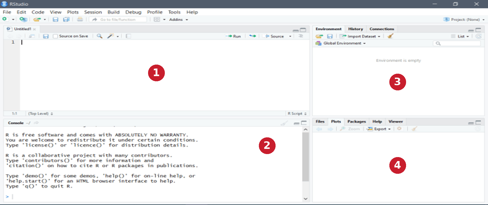

```{r}
#| label: setup
#| include: false
library(ggplot2)
theme_set(theme_minimal(base_size = 18))
colores <- c("Gris", "Verde", "Gris", "Verde", "Blanco",
             "Negro", "Amarillo", "Azul", "Gris", "Gris",
             "Gris", "Verde", "Negro", "Amarillo", "Blanco",
             "Blanco", "Negro", "Verde", "Verde", "Azul",
             "Negro", "Gris", "Verde", "Gris", "Negro")

frec <- sort(table(colores), decreasing = TRUE)
df_colores <- data.frame(Color = names(frec), f_i = as.vector(frec))
df_colores$h_i  <- df_colores$f_i / sum(df_colores$f_i)
df_colores$porc <- 100 * df_colores$h_i
tiempos <- c(14, 48, 20, 26, 23, 18, 39, 28, 17, 20, 64, 7, 35, 22, 58,
             25, 30, 40, 34, 31, 24, 42, 16, 33, 53, 21, 10, 9, 44, 24,
             37, 50, 30, 15, 45, 13, 12, 32, 18, 27)
limites <- seq(5, 65, by = 10)
clases  <- cut(tiempos, breaks = limites, right = FALSE)
f_i <- as.vector(table(clases))
tabla_tiempos <- data.frame(
  Clase = levels(clases),
  x_i   = (head(limites, -1) + tail(limites, -1)) / 2,
  f_i   = f_i,
  h_i   = f_i / sum(f_i),
  F_i   = cumsum(f_i),
  H_i   = cumsum(f_i) / sum(f_i)
)
```

## Contenido

1. ¿Qué es la estadística?
2. Población, muestra, parámetro y estadístico
3. Variables y datos
4. Escalas de medida
5. Análisis de datos cualitativos
6. Análisis de datos cuantitativos
7. Medidas numéricas descriptivas
8. Análisis de datos con R

::: notes
Presione M para abrir el menú de diapositivas, F para pantalla completa,
C para la pizarra y B para el lápiz sobre la diapositiva.
:::

# ¿Qué es la estadística? {background-color="#2c5d8f"}

## Los datos varían

::: {.incremental}
- Dos cilindros de la **misma mezcla** de concreto no resisten lo mismo.
- Dos hogares **parecidos** no tienen el mismo ingreso.
- Dos pacientes no responden igual al **mismo** medicamento.
:::

. . .

::: {.callout-tip title="Idea clave"}
Si todos los datos fueran iguales, bastaría observar uno. La razón de ser
de la estadística es la **variabilidad**.
:::

## Definición

::: {.callout-note title="Estadística"}
Ciencia que se ocupa de **recolectar, organizar, resumir, analizar e
interpretar datos**, para describir fenómenos y apoyar la toma de
decisiones en condiciones de **incertidumbre**.
:::

:::: {.columns}
::: {.column width="50%"}
**Estadística descriptiva**

¿Cómo se comportaron *estos* datos?

→ Capítulo 1
:::
::: {.column width="50%"}
**Estadística inferencial**

¿Qué podemos afirmar *más allá* de los datos, y con qué confianza?

→ Estadística II
:::
::::

. . .

La **probabilidad** (capítulos 2 a 4) es el puente entre las dos.

# Población, muestra, parámetro y estadístico {background-color="#2c5d8f"}

## Población y muestra

- **Unidad de observación:** cada elemento sobre el que se registra
  información (una persona, una empresa, una pieza, un día).
- **Población:** el conjunto completo de unidades de interés. Tamaño $N$.
- **Muestra:** el subconjunto que efectivamente se observa. Tamaño $n$.

. . .

¿Por qué no observar a todos (un **censo**)?

::: {.incremental}
- Costo y tiempo.
- Imposibilidad de acceder a toda la población.
- La medición puede **destruir** la unidad (ensayos de resistencia).
:::

## La muestra debe ser representativa

- La forma más sencilla de procurarlo: seleccionarla **al azar**.
- Una encuesta respondida solo por quienes quieren participar en redes
  sociales puede estar **sesgada**, aunque tenga miles de respuestas.

. . .

::: {.callout-warning title="Pregunta para el grupo"}
¿Una muestra más grande es siempre mejor que una más pequeña?
:::

## Parámetro y estadístico

:::: {.columns}
::: {.column width="45%"}
**Parámetro:** describe a la **población**. Fijo, pero desconocido.

**Estadístico:** se calcula con la **muestra**. Conocido, pero cambia de
una muestra a otra.
:::
::: {.column width="55%"}
| Característica | Población | Muestra |
|:--|:--:|:--:|
| Tamaño | $N$ | $n$ |
| Media | $\mu$ | $\bar{x}$ |
| Varianza | $\sigma^2$ | $s^2$ |
| Desv. estándar | $\sigma$ | $s$ |
| Proporción | $p$ | $\hat{p}$ |
:::
::::

. . .

**Ejemplo:** la tasa de desempleo de Colombia es un parámetro; la cifra del
DANE, calculada con la Gran Encuesta Integrada de Hogares, es un
estadístico que lo estima.

## ¿Parámetro o estadístico?

Un banco revisa **todos** los créditos que otorgó en 2025 y encuentra que
el 4,2 % entró en mora.

. . .

::: {.fragment}
**Parámetro**: se calculó con toda la población de créditos de 2025.
:::

# Variables y datos {background-color="#2c5d8f"}

## Variables determinísticas y aleatorias

:::: {.columns}
::: {.column width="50%"}
**Determinística**

Su valor queda determinado por condiciones conocidas.

- Área de un terreno de lados conocidos.
- Valor final de un CDT a tasa fija.
:::
::: {.column width="50%"}
**Aleatoria**

Aun con las mismas condiciones, no se puede predecir.

- Clientes que llegan a un banco en una hora.
- Tiempo de espera de un bus.
:::
::::

## Cualitativas y cuantitativas

- **Cualitativa (categórica):** sus valores son categorías.
  Carrera, grupo sanguíneo, sector económico.
- **Cuantitativa:** sus valores son números con sentido aritmético.
  - **Discreta:** surge de **contar** (número de hijos, de defectos).
  - **Continua:** surge de **medir** (estatura, tiempo, resistencia).

. . .

::: {.callout-warning title="Cuidado con los códigos numéricos"}
El estrato (1 a 6), el código de una carrera o la cédula son números,
pero **no** son cuantitativos. Prueba: ¿tiene sentido el promedio?
:::

## Clasifique

::: {.incremental}
- Resistencia a la compresión del concreto (MPa) → *cuantitativa continua*
- Número de defectos en una lámina → *cuantitativa discreta*
- Sector económico de una empresa → *cualitativa*
- Estrato socioeconómico → *cualitativa (ordinal)*
- Ingreso mensual del hogar → *cuantitativa continua*
- Número de cédula → *cualitativa (es una etiqueta)*
:::

## La matriz de datos

Cada **fila** es una unidad, cada **columna** una variable y cada
**celda** un dato.

| Estudiante | Carrera | Estrato | Créditos | Estatura (cm) |
|:--:|:--|:--:|:--:|:--:|
| 1 | Ingeniería Civil | 3 | 18 | 172,4 |
| 2 | Economía | 2 | 16 | 160,1 |
| 3 | Química | 4 | 20 | 168,9 |
| 4 | Economía | 3 | 15 | 175,0 |
| 5 | Ingeniería Civil | 1 | 18 | 158,3 |
| 6 | Física | 2 | 17 | 181,2 |

# Escalas de medida {background-color="#2c5d8f"}

## Las cuatro escalas

| Escala | ¿Qué permite? | Ejemplos | Resúmenes adecuados |
|:--|:--|:--|:--|
| **Nominal** | $=, \neq$ | Género, grupo sanguíneo | Frecuencias, moda |
| **Ordinal** | $<, >$ | Estrato, satisfacción | + mediana, cuartiles |
| **Intervalo** | Diferencias | Temperatura en °C, año | + media, desviación |
| **Razón** | Cocientes | Peso, ingreso, tiempo | + coef. de variación |

. . .

- En la escala de **intervalo** el cero es arbitrario: 0 °C no es
  "ausencia de temperatura".
- En la de **razón** hay un cero absoluto: 80 kg sí es el doble de 40 kg.

## ¿Hace el doble de calor?

Un día, una ciudad está a 30 °C y otra a 15 °C. ¿Hace "el doble de calor"
en la primera?

. . .

::: {.fragment}
**No.** La temperatura en °C está en escala de intervalo: el cociente no
tiene sentido. En kelvin (escala de razón): 303,15 K frente a 288,15 K,
apenas un 5 % más.
:::

. . .

::: {.callout-note title="Una advertencia"}
Las escalas son una guía, no una regla mecánica: las escalas Likert son
ordinales, pero a menudo se promedian. Hacerlo exige justificarlo.
:::

# Análisis de datos cualitativos {background-color="#2c5d8f"}

## Tabla de frecuencias

| Símbolo | Nombre | Fórmula |
|:--:|:--|:--|
| $f_i$ | Frecuencia absoluta | número de datos en la categoría $i$ |
| $h_i$ | Frecuencia relativa | $h_i = f_i / n$ |
| $F_i$ | Frecuencia absoluta acumulada | $F_i = f_1 + \cdots + f_i$ |
| $H_i$ | Frecuencia relativa acumulada | $H_i = F_i / n$ |

. . .

- Las categorías deben ser **excluyentes** (ningún dato en dos) y
  **exhaustivas** (ningún dato sin categoría).
- Las acumuladas solo tienen sentido si hay **orden** (ordinales y
  cuantitativas).
- Para variables nominales, el valor típico es la **moda**.

## Ejemplo: color de vehículo preferido

:::: {.columns}
::: {.column width="45%"}
```{r}
#| echo: false
tabla_colores <- rbind(
  df_colores,
  data.frame(Color = "Total", f_i = sum(df_colores$f_i), h_i = 1, porc = 100)
)
knitr::kable(tabla_colores, format = "pipe",
             col.names = c("Color", "$f_i$", "$h_i$", "Porcentaje (%)"),
             digits = c(0, 0, 2, 1), align = "lccc")
```
:::
::: {.column width="55%"}
```{r}
#| echo: false
#| fig-width: 6
#| fig-height: 4.5
#| fig-align: center
ggplot(df_colores, aes(x = reorder(Color, -f_i), y = f_i)) +
  geom_col(fill = "steelblue", width = 0.7) +
  geom_text(aes(label = f_i), vjust = -0.4) +
  labs(x = "Color preferido", y = "Frecuencia absoluta") +
  ylim(0, 8)
```
:::
::::

La **moda** es el gris (28 %); gris, verde y negro reúnen el 72 %.

## ¿Barras o pastel?

:::: {.columns}
::: {.column width="50%"}
```{r}
#| echo: false
#| fig-width: 5.5
#| fig-height: 4.5
#| fig-align: center
ggplot(df_colores, aes(x = reorder(Color, -f_i), y = f_i)) +
  geom_col(fill = "steelblue", width = 0.7) +
  geom_text(aes(label = f_i), vjust = -0.4) +
  labs(x = "Color preferido", y = "Frecuencia absoluta") +
  ylim(0, 8)
```
:::
::: {.column width="50%"}
```{r}
#| echo: false
#| fig-width: 5
#| fig-height: 4.5
#| fig-align: center
ggplot(df_colores, aes(x = "", y = f_i, fill = Color)) +
  geom_col(width = 1, color = "white") +
  coord_polar(theta = "y") +
  geom_text(aes(label = paste0(round(porc), " %")),
            position = position_stack(vjust = 0.5)) +
  labs(fill = "Color") +
  theme_void()
```
:::
::::

Comparamos mejor **longitudes** que ángulos [@healy2018]: prefiera las
barras; use el pastel solo con pocas categorías.

## Tablas de contingencia

| Hábito de fumar | Hombre | Mujer | Total |
|:--|:--:|:--:|:--:|
| Sí | 65 | 58 | 123 |
| No | 43 | 67 | 110 |
| Total | 108 | 125 | 233 |

. . .

Tres formas de calcular porcentajes, tres preguntas distintas:

::: {.incremental}
- **Del total:** ¿qué % son hombres fumadores? $65/233 \approx 0{,}279$ (27,9 %)
- **Por columna:** ¿qué % de los hombres fuma? $65/108 \approx 0{,}602$ (60,2 %); de las mujeres, 46,4 %
- **Por fila:** de los que fuman, ¿qué % son hombres? $65/123 \approx 0{,}528$ (52,8 %)
:::

## ¿Fuman más los hombres?

:::: {.columns}
::: {.column width="55%"}
```{r}
#| echo: false
#| fig-width: 5.5
#| fig-height: 4.5
#| fig-align: center
fumar <- data.frame(
  genero = rep(c("Hombre", "Mujer"), each = 2),
  fuma   = rep(c("Sí", "No"), times = 2),
  n      = c(65, 43, 58, 67)
)
fumar$porc <- 100 * fumar$n / ave(fumar$n, fumar$genero, FUN = sum)
fumar$fuma <- factor(fumar$fuma, levels = c("No", "Sí"))

ggplot(fumar, aes(x = genero, y = porc, fill = fuma)) +
  geom_col(width = 0.6) +
  geom_text(aes(label = paste0(round(porc, 1), " %")),
            position = position_stack(vjust = 0.5), color = "white") +
  scale_fill_manual(values = c("No" = "grey55", "Sí" = "firebrick")) +
  labs(x = "Género", y = "Porcentaje", fill = "¿Fuma?")
```
:::
::: {.column width="45%"}
Para comparar grupos de distinto tamaño, se usan los **porcentajes por
columna**.

::: {.callout-tip title="Conexión con el capítulo 2"}
Estos porcentajes anticipan la probabilidad **conjunta**, **marginal** y
**condicional**.
:::
:::
::::

# Análisis de datos cuantitativos {background-color="#2c5d8f"}

## Ejemplo: tiempo de desplazamiento

Minutos que tardan 40 estudiantes en llegar a la universidad:

> 14, 48, 20, 26, 23, 18, 39, 28, 17, 20, 64, 7, 35, 22, 58, 25, 30, 40,
> 34, 31, 24, 42, 16, 33, 53, 21, 10, 9, 44, 24, 37, 50, 30, 15, 45, 13,
> 12, 32, 18, 27

. . .

**Arreglo ordenado:**

> 7, 9, 10, 12, 13, 14, 15, 16, 17, 18, 18, 20, 20, 21, 22, 23, 24, 24,
> 25, 26, 27, 28, 30, 30, 31, 32, 33, 34, 35, 37, 39, 40, 42, 44, 45, 48,
> 50, 53, 58, 64

## Diagrama de tallo y hojas

:::: {.columns}
::: {.column width="45%"}
```
Tallo | Hojas
    0 | 7 9
    1 | 0 2 3 4 5 6 7 8 8
    2 | 0 0 1 2 3 4 4 5 6 7 8
    3 | 0 0 1 2 3 4 5 7 9
    4 | 0 2 4 5 8
    5 | 0 3 8
    6 | 4
```
Leyenda: 1 | 5 = 15 minutos
:::
::: {.column width="55%"}
- Ordena los datos **y** muestra su forma.
- Conserva todos los valores originales.
- Girado 90°, se ve como un histograma: la mayoría tarda entre 10 y 39
  minutos y unos pocos bastante más.
:::
::::

## Variables discretas con pocos valores

:::: {.columns}
::: {.column width="50%"}
Número de hermanos de 30 estudiantes:

| $x_i$ | $f_i$ | $h_i$ | $F_i$ | $H_i$ |
|:--:|:--:|:--:|:--:|:--:|
| 0 | 5 | 0,167 | 5 | 0,167 |
| 1 | 11 | 0,367 | 16 | 0,533 |
| 2 | 8 | 0,267 | 24 | 0,800 |
| 3 | 4 | 0,133 | 28 | 0,933 |
| 4 | 2 | 0,067 | 30 | 1,000 |
:::
::: {.column width="50%"}
```{r}
#| echo: false
#| fig-width: 5
#| fig-height: 4
#| fig-align: center
hermanos <- data.frame(x = 0:4, n = c(5, 11, 8, 4, 2))
ggplot(hermanos, aes(x = x, y = n)) +
  geom_segment(aes(xend = x, yend = 0), linewidth = 1.2, color = "steelblue") +
  geom_point(size = 3, color = "steelblue") +
  scale_x_continuous(breaks = 0:4) +
  labs(x = "Número de hermanos", y = "Frecuencia absoluta")
```

El 80 % tiene **a lo sumo** dos hermanos ($H_3$).
:::
::::

## Tabla de frecuencias agrupadas: pasos

1. **Rango:** $R = \text{máx} - \text{mín} = 64 - 7 = 57$.
2. **Número de clases** (Sturges): $k \approx 1 + \log_2 n = 1 + \log_2 40 \approx 6$.
3. **Amplitud:** $c \approx R/k = 9{,}5 \Rightarrow c = 10$ (redondear hacia arriba).
4. **Primer límite:** $L_0 = 5$; verificar que la última clase contenga al máximo.
5. **Contar** y calcular $f_i$, $h_i$, $F_i$, $H_i$.

. . .

Convención: $[L_{i-1}, L_i)$ incluye el límite inferior y excluye el
superior. El dato 25 va en $[25, 35)$.

## La tabla agrupada

```{r}
#| echo: false
knitr::kable(tabla_tiempos, format = "pipe",
             col.names = c("Clase", "$x_i$", "$f_i$", "$h_i$", "$F_i$", "$H_i$"),
             digits = c(0, 0, 0, 2, 0, 2), align = "cccccc")
```

- Clase con más estudiantes: $[15, 25)$, con el 30 %.
- El 70 % tarda menos de 35 minutos ($H_3 = 0{,}70$).
- Al agrupar se **pierde** el valor exacto de cada dato.

## Histograma y polígono de frecuencias

:::: {.columns}
::: {.column width="50%"}
```{r}
#| echo: false
#| fig-width: 5.5
#| fig-height: 4.2
#| fig-align: center
ggplot(data.frame(tiempo = tiempos), aes(x = tiempo)) +
  geom_histogram(breaks = limites, closed = "left",
                 fill = "steelblue", color = "white") +
  scale_x_continuous(breaks = limites) +
  labs(x = "Tiempo de desplazamiento (minutos)", y = "Frecuencia absoluta")
```
:::
::: {.column width="50%"}
```{r}
#| echo: false
#| fig-width: 5.5
#| fig-height: 4.2
#| fig-align: center
poligono <- data.frame(x = c(0, tabla_tiempos$x_i, 70),
                       n = c(0, tabla_tiempos$f_i, 0))
ggplot(data.frame(tiempo = tiempos), aes(x = tiempo)) +
  geom_histogram(breaks = limites, closed = "left",
                 fill = "grey85", color = "white") +
  geom_line(data = poligono, aes(x = x, y = n), color = "firebrick",
            linewidth = 1) +
  geom_point(data = poligono, aes(x = x, y = n), color = "firebrick",
             size = 2.5) +
  scale_x_continuous(breaks = seq(0, 70, by = 10)) +
  labs(x = "Tiempo de desplazamiento (minutos)", y = "Frecuencia absoluta")
```
:::
::::

- **Histograma:** rectángulos **contiguos**; base = clase, altura = frecuencia.
- **Polígono:** une los puntos $(x_i, f_i)$; útil para comparar grupos.

## Ojiva

:::: {.columns}
::: {.column width="60%"}
```{r}
#| echo: false
#| fig-width: 6
#| fig-height: 4.5
#| fig-align: center
ojiva <- data.frame(L = limites, F = c(0, tabla_tiempos$H_i))
ggplot(ojiva, aes(x = L, y = 100 * F)) +
  geom_line(color = "steelblue", linewidth = 1) +
  geom_point(color = "steelblue", size = 2.5) +
  annotate("segment", x = 5, xend = 27, y = 50, yend = 50,
           linetype = "dashed", color = "grey40") +
  annotate("segment", x = 27, xend = 27, y = 0, yend = 50,
           linetype = "dashed", color = "grey40") +
  scale_x_continuous(breaks = limites) +
  scale_y_continuous(breaks = seq(0, 100, by = 25)) +
  labs(x = "Tiempo de desplazamiento (minutos)",
       y = "Frecuencia relativa acumulada (%)")
```
:::
::: {.column width="40%"}
Une los puntos $(L_i, H_i)$.

Responde: ¿qué % está por debajo de un valor?

- 70 % tarda menos de 35 min.
- La mitad tarda menos de unos **27 min** (≈ la mediana).
:::
::::

## Forma de una distribución

```{r}
#| echo: false
#| fig-width: 9
#| fig-height: 5.2
#| fig-align: center
set.seed(123)
m <- 2000
formas <- data.frame(
  valor = c(rnorm(m, 50, 10),
            rgamma(m, shape = 2, scale = 10),
            100 - rgamma(m, shape = 2, scale = 10),
            c(rnorm(m / 2, 35, 6), rnorm(m / 2, 65, 6))),
  forma = factor(rep(c("Simétrica", "Asimétrica a la derecha",
                       "Asimétrica a la izquierda", "Bimodal"), each = m),
                 levels = c("Simétrica", "Asimétrica a la derecha",
                            "Asimétrica a la izquierda", "Bimodal"))
)
ggplot(formas, aes(x = valor)) +
  geom_histogram(bins = 30, fill = "steelblue", color = "white") +
  facet_wrap(~ forma, scales = "free") +
  labs(x = NULL, y = "Frecuencia")
```

## Interpretación de una tabla

Tiempo de atención de 100 clientes de una compañía de comunicaciones:

| Tiempo (min) | [15,20) | [20,25) | [25,30) | [30,35) | [35,40) | [40,45) | [45,50) |
|:--|:--:|:--:|:--:|:--:|:--:|:--:|:--:|
| Frecuencia | 5 | 19 | 27 | 29 | 7 | 5 | 8 |
| % acumulado | 5 | 24 | 51 | 80 | 87 | 92 | 100 |

::: {.incremental}
- ¿Cuántos fueron atendidos en menos de 45 minutos? → **92 clientes**
- ¿Qué % esperó al menos 40 minutos? → $5 + 8 = 13$, es decir, **13 %**
:::

# Medidas numéricas descriptivas {background-color="#2c5d8f"}

## Cuatro tipos de medidas

| Tipo | Pregunta | Ejemplos |
|:--|:--|:--|
| Tendencia central | ¿Alrededor de qué valor están los datos? | Media, mediana, moda |
| Dispersión | ¿Qué tan alejados están entre sí? | Rango, $s$, $CV$, $RIC$ |
| Posición | ¿Qué valor deja cierto % por debajo? | Cuartiles, percentiles |
| Forma | ¿Es simétrica? ¿Tiene colas pesadas? | $b_1$, $A_P$, $b_2$, $K$ |

. . .

Notación: datos $x_1, \ldots, x_n$; ordenados
$x_{(1)} \le x_{(2)} \le \cdots \le x_{(n)}$.

## Media aritmética

$$
\bar{x} = \frac{1}{n}\sum_{i=1}^{n} x_i
\qquad\qquad
\mu = \frac{1}{N}\sum_{i=1}^{N} x_i
$$

- Es el **centro de gravedad**: $\sum (x_i - \bar{x}) = 0$.
- Tiempos de desplazamiento: $\bar{x} = 1154/40 = 28{,}85$ minutos.

. . .

**Media ponderada:** $\bar{x}_w = \dfrac{\sum w_i x_i}{\sum w_i}$

| Asignatura | Créditos | Nota |
|:--|:--:|:--:|
| Cálculo I | 4 | 3,5 |
| Álgebra lineal | 3 | 4,2 |
| Estadística I | 3 | 4,0 |
| Inglés | 2 | 4,8 |

Promedio ponderado: $48{,}2/12 = 4{,}02$; promedio simple: $4{,}13$.

## Mediana y moda

$$
Me =
\begin{cases}
x_{\left(\frac{n+1}{2}\right)} & n \text{ impar}\\[2mm]
\dfrac{x_{\left(\frac{n}{2}\right)} + x_{\left(\frac{n}{2}+1\right)}}{2} & n \text{ par}
\end{cases}
$$

::: {.incremental}
- 54, 21, 53, 33, 10 → ordenados 10, 21, **33**, 53, 54 → $Me = 33$.
- Tiempos ($n = 40$): $Me = (26 + 27)/2 = 26{,}5$ minutos.
- **Moda:** el valor más frecuente. Única medida para variables nominales;
  en continuas se usa la **clase modal**: $[15, 25)$.
:::

## ¿Media o mediana?

Salarios (millones) de seis empleados: 2,0; 2,2; 2,4; 2,5; 2,9 y **15,0**
(el gerente).

. . .

:::: {.columns}
::: {.column width="50%"}
**Media:** $27/6 = 4{,}5$

No representa a nadie: cinco de seis ganan menos de 3 millones.
:::
::: {.column width="50%"}
**Mediana:** $(2{,}4 + 2{,}5)/2 = 2{,}45$

Representa el salario típico.
:::
::::

. . .

La mediana es **robusta**: no la afectan los valores extremos. En los
tiempos, $\bar{x} = 28{,}85 > Me = 26{,}5$: la cola derecha "jala" la media.

## Medidas de dispersión

- **Rango:** $R = x_{(n)} - x_{(1)}$. Sencillo, pero depende solo de dos datos.
- **Varianza y desviación estándar:**

$$
s^2 = \frac{1}{n-1}\sum_{i=1}^{n}(x_i - \bar{x})^2,
\qquad s = \sqrt{s^2}
\qquad\qquad
\sigma^2 = \frac{1}{N}\sum_{i=1}^{N}(x_i - \mu)^2
$$

. . .

::: {.callout-tip title="¿Por qué n − 1?"}
Las $n$ desviaciones suman cero: solo $n - 1$ son "libres" (**grados de
libertad**). Además, así $s^2$ no subestima a $\sigma^2$ (Estadística II).
:::

## Varianza paso a paso

:::: {.columns}
::: {.column width="50%"}
Datos: 54, 21, 53, 33, 10; $\bar{x} = 34{,}2$

| $x_i$ | $x_i - \bar{x}$ | $(x_i - \bar{x})^2$ |
|:--:|:--:|:--:|
| 54 | 19,8 | 392,04 |
| 21 | −13,2 | 174,24 |
| 53 | 18,8 | 353,44 |
| 33 | −1,2 | 1,44 |
| 10 | −24,2 | 585,64 |
| Suma | 0,0 | 1506,80 |
:::
::: {.column width="50%"}
$$
s^2 = \frac{1506{,}80}{4} = 376{,}70
$$
$$
s = \sqrt{376{,}70} = 19{,}41
$$

Tiempos: $s = 13{,}98$ min.
:::
::::

## Regla empírica y coeficiente de variación

Si el histograma tiene forma de campana:

- cerca del **68 %** de los datos está en $\bar{x} \pm s$;
- cerca del **95 %** en $\bar{x} \pm 2s$.

Tiempos: 27 de 40 (67,5 %) y 38 de 40 (95 %).

. . .

$$
CV = \frac{s}{\bar{x}} \times 100
$$

- Compara dispersiones con **unidades distintas** (solo escala de razón).
- Estatura: 4,8 %; peso: 16,9 % → el peso es más variable.
- Tiempos: $CV = 48{,}5$ %.

## Percentiles, deciles y cuartiles

Aproximadamente el $k$ % de los datos es **menor o igual** que $P_k$.

1. Posición: $p = \dfrac{(n-1)\,k}{100} + 1$
2. Parte entera: $j = [\![\, p \,]\!]$
3. $P_k = x_{(j)} + (p - j)\left(x_{(j+1)} - x_{(j)}\right)$

Es el método de R (`quantile()`) y Excel (`PERCENTIL.INC`).

. . .

| | $p$ | Resultado |
|:--|:--:|:--:|
| $Q_1 = P_{25}$ | 10,75 | 18 |
| $Q_2 = P_{50}$ | 20,5 | 26,5 |
| $Q_3 = P_{75}$ | 30,25 | 37,5 |
| $D_1$, $D_9$ | 4,9 ; 36,1 | 12,9 ; 48,2 |

## ¿"Menos de" o "como máximo"?

$Q_1 = 18$ minutos. Hay **dos** estudiantes que tardan exactamente 18:

- *menos de* 18: 9 de 40 (22,5 %);
- *18 o menos*: 11 de 40 (27,5 %).

. . .

Interpretación correcta: **aproximadamente el 25 % tarda 18 minutos o
menos**.

. . .

**Rango intercuartílico:** $RIC = Q_3 - Q_1 = 37{,}5 - 18 = 19{,}5$
minutos. Es al rango lo que la mediana es a la media: **robusto**.

## Diagrama de caja y bigotes

:::: {.columns}
::: {.column width="45%"}
1. Caja de $Q_1$ a $Q_3$, línea en $Me$.
2. Límites: $Q_1 - 1{,}5\,RIC$ y $Q_3 + 1{,}5\,RIC$.
3. Bigotes hasta el último dato dentro de los límites.
4. Fuera de ellos: **atípicos**.
:::
::: {.column width="55%"}
Tiempos: límites $-11{,}25$ y $66{,}75$ → sin atípicos.

```{r}
#| echo: false
#| fig-width: 6
#| fig-height: 2.6
#| fig-align: center
ggplot(data.frame(tiempo = tiempos), aes(x = tiempo, y = "")) +
  stat_boxplot(geom = "errorbar", width = 0.25, orientation = "y") +
  geom_boxplot(fill = "lightsteelblue", width = 0.5) +
  scale_x_continuous(breaks = seq(0, 70, by = 10)) +
  labs(x = "Tiempo de desplazamiento (minutos)", y = NULL)
```

Salarios: el del gerente es atípico.

```{r}
#| echo: false
#| fig-width: 6
#| fig-height: 2.6
#| fig-align: center
salarios <- c(2.0, 2.2, 2.4, 2.5, 2.9, 15.0)
ggplot(data.frame(salario = salarios), aes(x = salario, y = "")) +
  stat_boxplot(geom = "errorbar", width = 0.25, orientation = "y") +
  geom_boxplot(fill = "lightsteelblue", width = 0.5,
               outlier.color = "firebrick", outlier.size = 3) +
  labs(x = "Salario mensual (millones de pesos)", y = NULL)
```
:::
::::

::: notes
Un valor atípico no es un error: hay que averiguar a qué se debe antes de
decidir qué hacer con él.
:::

## Asimetría

```{r}
#| echo: false
#| fig-width: 10
#| fig-height: 3.6
#| fig-align: center
formas_niv <- c("Asimétrica a la izquierda", "Simétrica", "Asimétrica a la derecha")
x1 <- seq(-4, 4, length.out = 400)
x2 <- seq(0, 9, length.out = 400)
curvas <- rbind(
  data.frame(forma = "Simétrica", x = x1, y = dnorm(x1)),
  data.frame(forma = "Asimétrica a la derecha", x = x2, y = dgamma(x2, shape = 2)),
  data.frame(forma = "Asimétrica a la izquierda", x = -x2, y = dgamma(x2, shape = 2))
)
med <- qgamma(0.5, shape = 2)
lineas <- data.frame(
  forma  = rep(c("Simétrica", "Asimétrica a la derecha",
                 "Asimétrica a la izquierda"), each = 3),
  medida = rep(c("Moda", "Mediana", "Media"), times = 3),
  x      = c(0, 0, 0, 1, med, 2, -1, -med, -2)
)
lineas$y <- ifelse(lineas$forma == "Simétrica", dnorm(lineas$x),
                   dgamma(abs(lineas$x), shape = 2))
curvas$forma <- factor(curvas$forma, levels = formas_niv)
lineas$forma <- factor(lineas$forma, levels = formas_niv)
lineas$medida <- factor(lineas$medida, levels = c("Moda", "Mediana", "Media"))

ggplot(curvas, aes(x = x, y = y)) +
  geom_line(color = "steelblue", linewidth = 1) +
  geom_segment(data = lineas,
               aes(x = x, xend = x, y = 0, yend = y, color = medida),
               linewidth = 0.9) +
  facet_wrap(~ forma, scales = "free_x") +
  scale_color_manual(values = c("Moda" = "darkgreen", "Mediana" = "orange",
                                "Media" = "firebrick")) +
  labs(x = NULL, y = NULL, color = NULL) +
  theme(axis.text = element_blank(), legend.position = "bottom")
```

$$
b_1 = \frac{m_3}{s^3},\quad m_3 = \frac{1}{n}\sum (x_i - \bar{x})^3
\qquad\qquad
A_P = \frac{3\,(\bar{x} - Me)}{s}
$$

Tiempos: $b_1 = 0{,}58$ y $A_P = 0{,}50$ → **asimetría moderada a la derecha**.

## Curtosis

:::: {.columns}
::: {.column width="55%"}
```{r}
#| echo: false
#| fig-width: 6
#| fig-height: 4
#| fig-align: center
x  <- seq(-5.5, 5.5, length.out = 700)
a4 <- 3.59                                  # escala de la curva platicúrtica
curt <- rbind(
  data.frame(tipo = "lepto", x = x, y = dt(x / 0.7, df = 5) / 0.7),
  data.frame(tipo = "meso",  x = x, y = dnorm(x)),
  data.frame(tipo = "plati", x = x,
             y = 2.5 / (2 * a4 * gamma(1/2.5)) * exp(-(abs(x) / a4)^2.5))
)
ggplot(curt, aes(x = x, y = y, color = tipo)) +
  geom_hline(yintercept = 0, linewidth = 0.6) +
  geom_vline(xintercept = 0, linewidth = 0.5) +
  geom_line(linewidth = 1) +
  scale_color_manual(values = c(lepto = "black", meso = "black", plati = "red"),
                     guide = "none") +
  annotate("text", x = 0.45, y = 0.53, label = "Leptocúrtica",
           hjust = 0, fontface = "bold") +
  annotate("text", x = 1.25, y = 0.37, label = "Mesocúrtica\n(normal)",
           hjust = 0, fontface = "bold") +
  annotate("segment", x = 1.2, xend = 0.78, y = 0.35, yend = dnorm(0.78)) +
  annotate("text", x = -2.6, y = 0.25, label = "Platicúrtica",
           hjust = 1, fontface = "bold") +
  annotate("segment", x = -2.55, xend = -2, y = 0.24,
           yend = 2.5 / (2 * a4 * gamma(1/2.5)) * exp(-(2 / a4)^2.5)) +
  theme_void()
```
:::
::: {.column width="45%"}
$$
b_2 = \frac{m_4}{s^4} - 3
$$

- $b_2 \approx 0$: mesocúrtica
- $b_2 > 0$: leptocúrtica
- $b_2 < 0$: platicúrtica

$K = \dfrac{RIC}{2(D_9 - D_1)}$; normal $\approx 0{,}263$.
:::
::::

Mide sobre todo el peso de las **colas** [@westfall2014]. Tiempos:
$b_2 = -0{,}42$ y $K = 0{,}276$ → no se aparta claramente de la normal.

## Resumen

| Medida | Tipo | ¿Robusta? | Tiempos |
|:--|:--|:--:|:--:|
| Media | Tendencia central | No | 28,85 |
| Mediana | Tendencia central | Sí | 26,5 |
| Desviación estándar | Dispersión | No | 13,98 |
| Coeficiente de variación | Dispersión | No | 48,5 % |
| Rango intercuartílico | Dispersión | Sí | 19,5 |
| $Q_1$ y $Q_3$ | Posición | Sí | 18 y 37,5 |
| $b_1$ y $A_P$ | Forma | No | 0,58 y 0,50 |

. . .

Distribución simétrica → **media y desviación estándar**.
Asimétrica o con atípicos → **mediana y RIC**.

# Análisis de datos con R {background-color="#2c5d8f"}

## R y RStudio

:::: {.columns}
::: {.column width="50%"}
**R** es el motor: hace los cálculos.

- Gratuito y de código abierto.
- Miles de paquetes.
- Análisis **reproducibles**.

<https://cran.r-project.org>
:::
::: {.column width="50%"}
**RStudio** es la cabina: desde ahí se maneja R.

- Se instala **después** de R.
- Se abre RStudio, no R.

<https://posit.co/download/rstudio-desktop/>

Sin computador: <https://posit.cloud>
:::
::::

## Las cuatro ventanas

{width="100%"}

(1) Editor · (2) Consola · (3) Entorno e historial · (4) Archivos,
gráficos, paquetes y ayuda. Ejecute desde el script con **Ctrl + Enter**.

## R como calculadora

:::: {.columns}
::: {.column width="50%"}
```{r}
#| echo: true
2 + 3 * 4
(2 + 3) * 4
2^10
sqrt(49)
```
:::
::: {.column width="50%"}
```{r}
#| echo: true
log(100)
round(3.14159, 2)
radio <- 3
pi * radio^2
```
:::
::::

::: {.callout-warning title="El decimal en R es el punto"}
`3.5`, no `3,5`. La coma separa los argumentos de una función.
:::

## Paquetes

R es el **celular**; los paquetes son las **aplicaciones**.

:::: {.columns}
::: {.column width="50%"}
**Instalar:** una sola vez, en la consola, con comillas.

```r
install.packages(c("readxl",
                   "ggplot2",
                   "e1071"))
```
:::
::: {.column width="50%"}
**Cargar:** cada vez que se abre R, al inicio del script, sin comillas.

```r
library(readxl)
library(ggplot2)
library(e1071)
```
:::
::::

. . .

`there is no package called...` → el paquete no está instalado o el nombre
está mal escrito.

## El directorio de trabajo

:::: {.columns}
::: {.column width="45%"}
```
Estadistica1/
├── Estadistica1.Rproj
├── datos/
├── scripts/
└── resultados/
```
:::
::: {.column width="55%"}
1. Cree la carpeta y sus subcarpetas.
2. Guarde las bases en `datos/`.
3. *File → New Project → Existing Directory*.
4. Verifique: `getwd()` y `list.files("datos")`.
:::
::::

. . .

Ruta **relativa**: `"datos/encuesta_estudiantes.xlsx"`, porque el archivo
está en la subcarpeta `datos` del directorio de trabajo.

En Windows: `"C:/Users/..."`, nunca `"C:\Users\..."`.

## Estructuras de datos

| Estructura | Dimensiones | Se crea con | Uso típico |
|:--|:--:|:--|:--|
| Vector | 1 | `c()`, `seq()` | Una variable |
| Factor | 1 | `factor()` | Una variable cualitativa |
| Matriz | 2 | `matrix()` | Tablas de contingencia |
| Arreglo | 2 o más | `array()` | Tablas de tres variables |
| Lista | 1 | `list()` | Resultados de funciones |
| Data frame | 2 | `data.frame()` | Una base de datos |

## Vectores y factores

:::: {.columns}
::: {.column width="50%"}
```{r}
#| echo: true
notas <- c(3.5, 4.2, 4.0, 4.8, 2.9)
notas[2]
notas[notas >= 4]
mean(notas)
```
:::
::: {.column width="50%"}
```{r}
#| echo: true
estrato <- factor(c(3, 2, 4, 3, 1),
                  levels = 1:6,
                  ordered = TRUE)
table(estrato)
```
:::
::::

Nominal → `factor` · Ordinal → `factor(..., ordered = TRUE)` ·
Intervalo o razón → `numeric`

## Importar datos desde Excel

```{r}
#| echo: true
library(readxl)
encuesta <- read_excel("datos/encuesta_estudiantes.xlsx")
encuesta$transporte <- factor(encuesta$transporte)
encuesta$estrato <- factor(encuesta$estrato, levels = 1:6, ordered = TRUE)
str(encuesta)
```

## Tablas y gráficos

:::: {.columns}
::: {.column width="45%"}
```{r}
#| echo: true
fi <- table(encuesta$transporte)
fi
round(100 * prop.table(fi), 1)
```
:::
::: {.column width="55%"}
```{r}
#| echo: true
#| fig-width: 6
#| fig-height: 4
barplot(sort(fi, decreasing = TRUE),
        col = "steelblue",
        ylab = "Frecuencia")
```
:::
::::

## Medidas descriptivas

:::: {.columns}
::: {.column width="50%"}
```{r}
#| echo: true
tiempos <- encuesta$tiempo
mean(tiempos)
median(tiempos)
sd(tiempos)
quantile(tiempos, c(0.25, 0.75))
```
:::
::: {.column width="50%"}
```{r}
#| echo: true
summary(tiempos)
IQR(tiempos)
library(e1071)
skewness(tiempos)
kurtosis(tiempos)
```
:::
::::

Los mismos resultados que obtuvimos a mano.

## Gráficos con ggplot2

```{r}
#| echo: true
#| fig-width: 9
#| fig-height: 3.8
library(ggplot2)
ggplot(encuesta, aes(x = tiempo, y = reorder(transporte, tiempo, FUN = median))) +
  stat_boxplot(geom = "errorbar", width = 0.3, orientation = "y") +
  geom_boxplot(fill = "lightsteelblue") +
  labs(x = "Tiempo de desplazamiento (minutos)", y = NULL)
```

`ggplot(datos, aes(...))` + `geom_...()` + `labs(...)`: el gráfico se
construye **por capas**.

## Para practicar

::: {.callout-important title="Proyecto: el servicio de entrega de pizzas"}
1266 entregas de una pizzería en mayo de 2014 [@heumann2022]. Metas del
gerente: máximo **30 minutos** y al menos **65 °C**; vino gratis si la
entrega tarda **más de 40 minutos**.

Realice un análisis exploratorio completo con R y entregue un informe de
una página (ejercicio 22 de los apuntes).
:::

- Base: `pizza_delivery.xlsx`, en la página del curso.
- Ejercicios del capítulo: en los **apuntes**.

## Referencias {.smaller .scrollable}

::: {#refs}
:::
